# LBC Wallet

A non-custodial desktop wallet for **LBRY Credits (LBC)** with a **built-in miner**, in the
spirit of the Monero GUI: hold, send and receive LBC, unlock your LBRY tips, and mine with
your computer, all in one app. Windows, macOS and Linux.

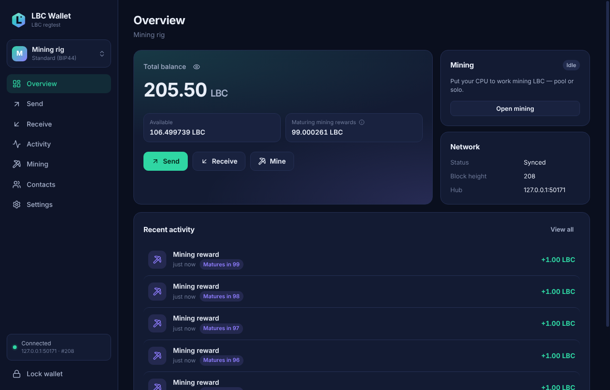

| Mining | Sending |
| --- | --- |
| 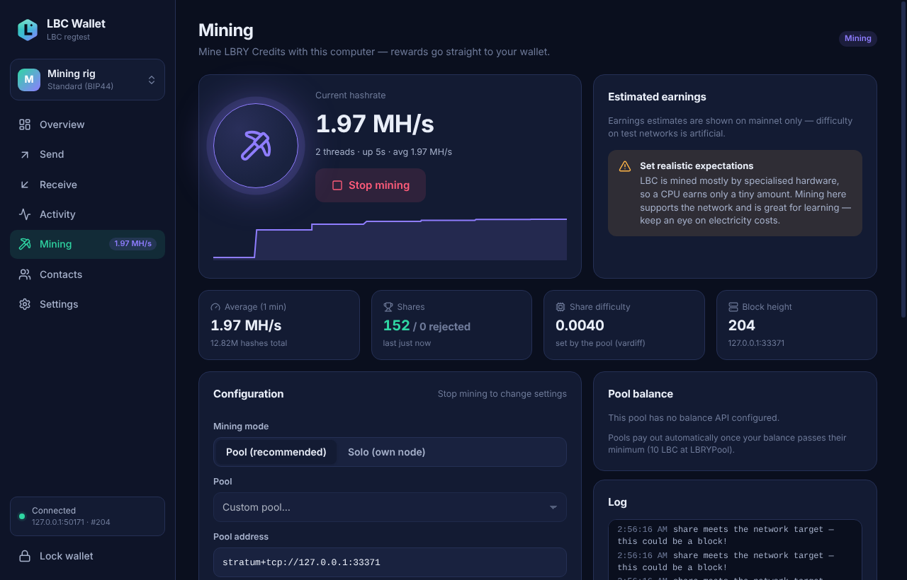 | 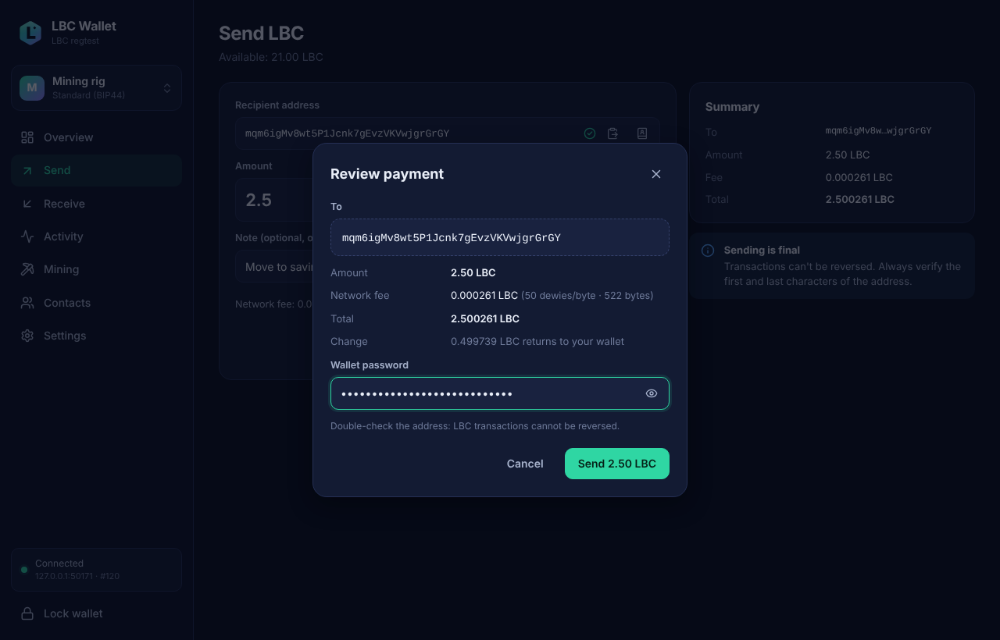 |
| **Activity with SPV-verified confirmations** | **Light theme** |
| 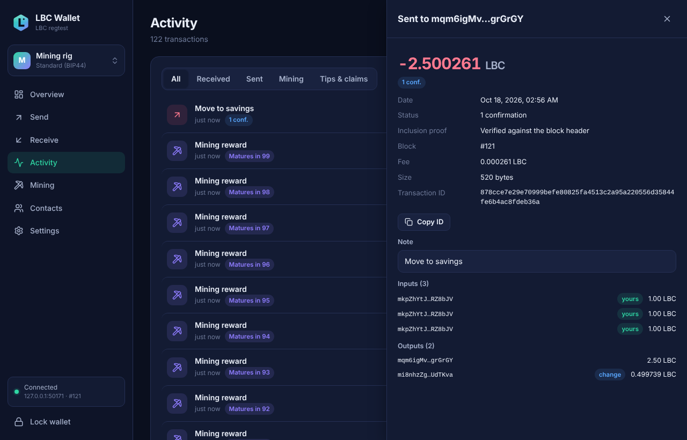 | 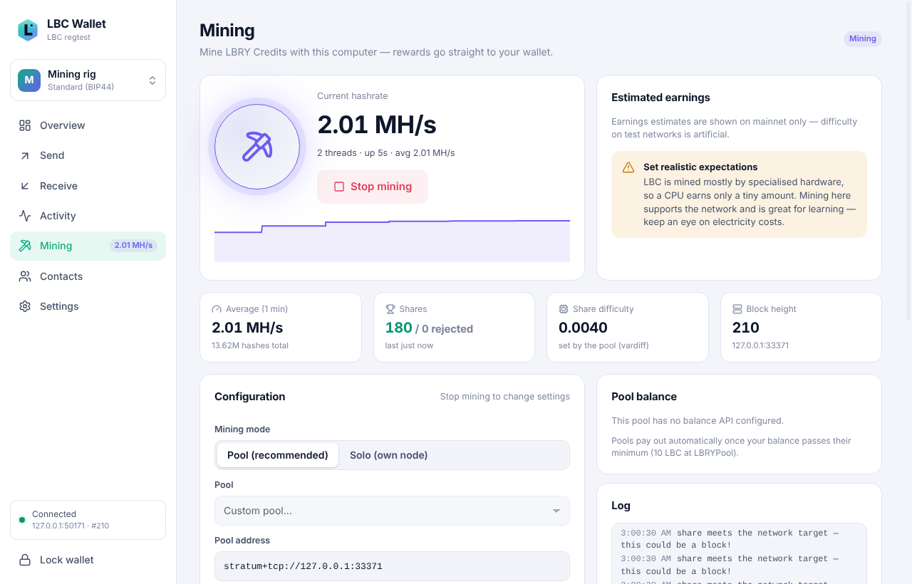 |

More screenshots

| | |
| --- | --- |
| 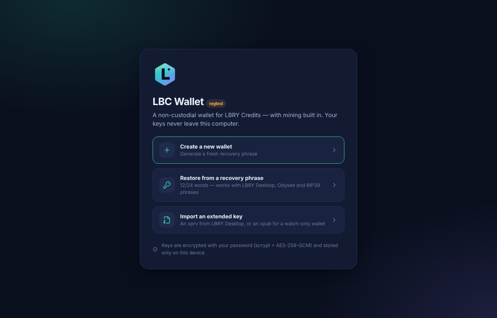 | 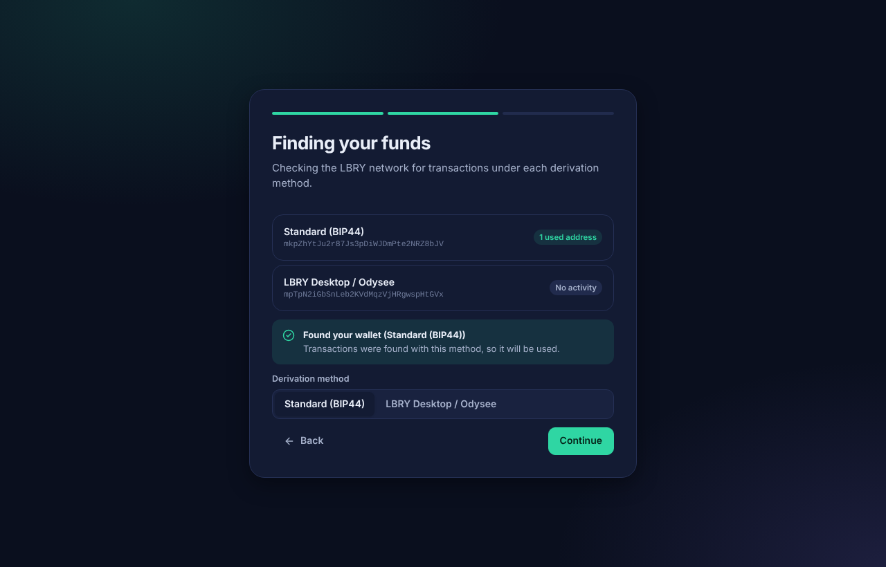 |
| 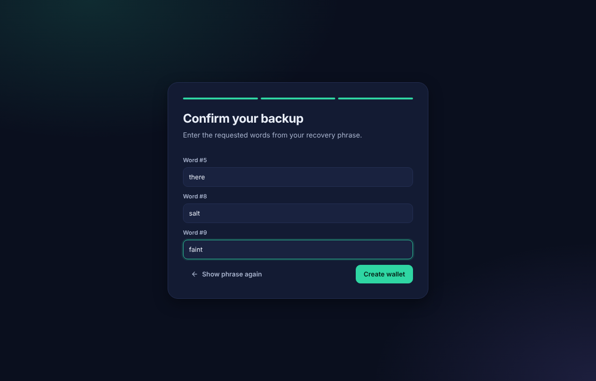 | 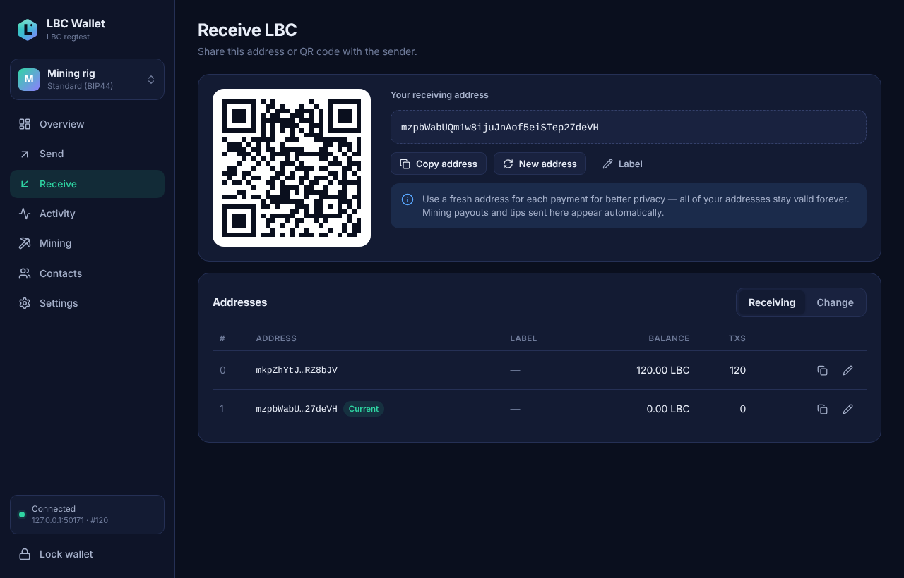 |
| 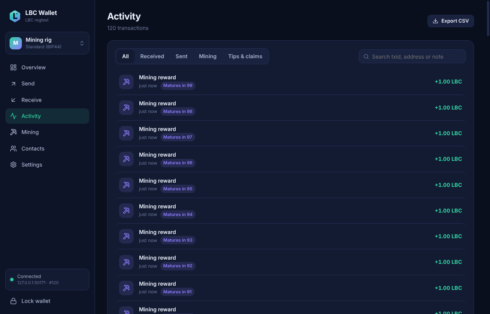 | 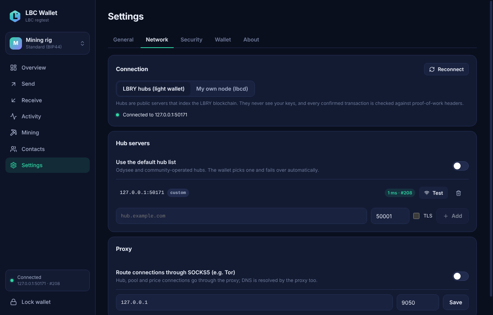 |
| 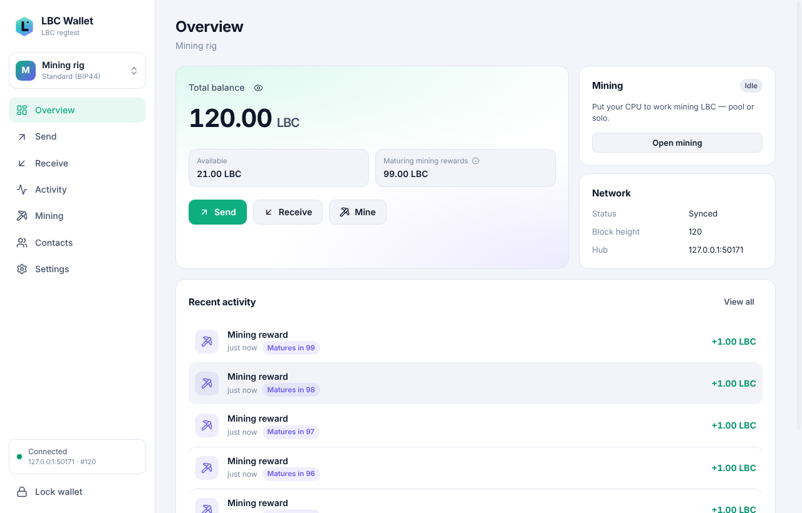 | 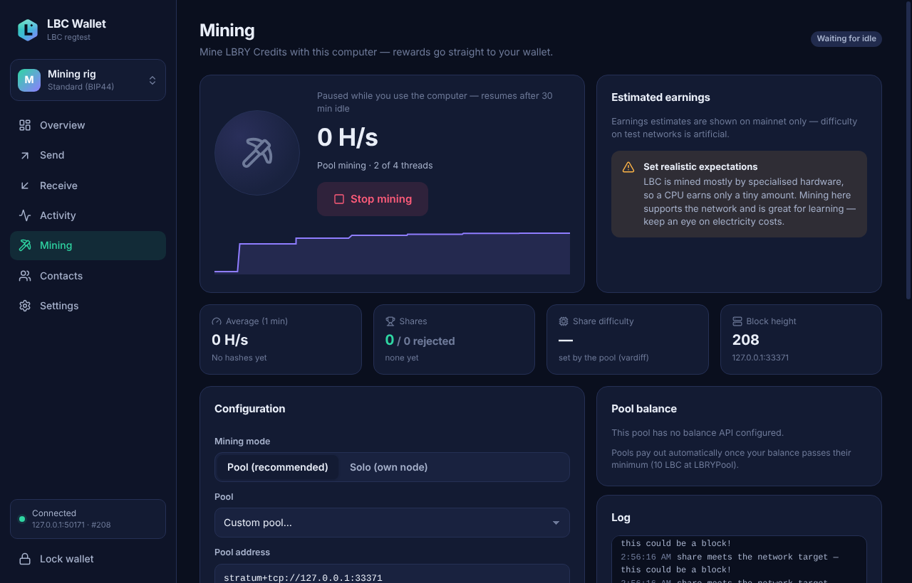 |

The screenshots come from the automated UI test running on a local regtest network.

## Features

**Wallet**

* **Non-custodial.** Keys are created and kept on your computer, encrypted with your password
  (scrypt + AES-256-GCM). No account, no server that can freeze or move your coins.
* **Restore what you already have.** LBRY Desktop / Odysee app recovery phrases (lbry-sdk
  format) and standard BIP39 phrases (12 or 24 words); the derivation is detected
  automatically. Account keys (`xprv`) can be imported, and `xpub` keys give you watch-only wallets.
* Send and receive with QR codes, an address book, notes, live fee preview and a full review
  step before anything is signed.
* **LBRY tips and supports** are shown separately and can be unlocked into your spendable
  balance in one click. Claims (channels, content) are never spent.
* Activity with filters, search and CSV export. Confirmations are **SPV-verified**: every
  merkle proof is checked against a proof-of-work-valid block header.
* Several wallets side by side, auto-lock (also on sleep and screen lock), password on every
  send (on by default), clipboard clearing for sensitive data, optional fiat prices.
* Connects to public LBRY hubs with automatic failover, to hubs you choose, or to **your own
  `lbcd` full node**. Optional **SOCKS5 / Tor** for every connection.

**Miner**

* Mine LBC from the wallet with your CPU, **through a pool** (Stratum, LBRYPool preset) or
  **solo** against your own `lbcd` node. Rewards go straight to your wallet.
* A WebAssembly SIMD implementation of LBRY's proof of work hashes four nonces per pass
  (about 3× the scalar speed), on as many threads as you choose.
* Runs in a separate low-priority process, so the wallet stays responsive. **Pause on
  battery** and **mine only when the computer is idle** (pauses the moment you're back).
* Live hashrate chart, accepted and rejected shares, pool balance, earnings estimate and a
  miner log.

> **Be realistic about mining income.** The LBC network is mined mostly by specialised
> hardware, so a CPU earns a tiny amount of LBC per day (see [docs/MINING.md](docs/MINING.md)).
> Mine to support the network, to learn, or to put idle hardware to use. Don't expect it to
> pay for the electricity.

## Download and install

Installers are attached to each [GitHub release](../../releases) (built by
[the release workflow](.github/workflows/release.yml)):

| System | Files |
| --- | --- |
| Windows 10/11 (x64) | `LBC Wallet-Setup-<version>.exe` (installer) or `LBC Wallet-Portable-<version>.exe` |
| macOS 11+ (Apple Silicon and Intel) | `LBC Wallet-<version>-mac-arm64.dmg` / `-mac-x64.dmg` |
| Linux (x64) | `lbc-wallet_<version>_amd64.deb`, `LBC Wallet-<version>-linux-x86_64.AppImage`, `.tar.gz` |

Check downloads against the `SHA256SUMS-*.txt` files in the release.

* **Unsigned builds.** Unless the release says it is signed, Windows SmartScreen will warn
  (*More info → Run anyway*). On macOS, open the app once, then allow it under *System Settings →
  Privacy & Security → Open Anyway* (right-click *→ Open* on macOS 14 and older).
* **Ubuntu 24.04 and newer** restrict the user namespaces that Electron's sandbox uses. Prefer
  the `.deb`, which installs an AppArmor profile for the app. The AppImage needs the restriction
  relaxed (`sudo sysctl kernel.apparmor_restrict_unprivileged_userns=0`) or an AppArmor profile.
  Please don't run the wallet with `--no-sandbox`.

Your wallets and settings live in the app data folder: `%APPDATA%\LBC Wallet` on Windows,
`~/Library/Application Support/LBC Wallet` on macOS, and `~/.config/LBC Wallet` on Linux.

## Getting started

1. **Create a wallet** and write the 12 recovery words on paper. The app asks for three of
   them before it finishes. Anyone with these words controls your LBC. Nobody can recover
   them for you.
2. Or **restore** an existing LBRY or BIP39 phrase. The wallet scans both derivation schemes
   and shows which one holds your funds.
3. **Receive** shows a fresh address and QR code. **Send** previews the fee, asks for your
   password and shows exactly what will be signed.
4. **Mining**: pick the pool (LBRYPool is preset) or solo, choose how many CPU threads to
   use, and press *Start mining*. Pool payouts arrive in the wallet once the pool's minimum
   is reached. See [docs/MINING.md](docs/MINING.md).

## Documentation

* [Mining guide](docs/MINING.md): pools, solo mining with lbcd, idle mining, expectations, troubleshooting
* [Security model](docs/SECURITY.md): what protects your funds and your privacy
* [Architecture](docs/ARCHITECTURE.md): how the wallet core, sync, signing and miner work
* [Building from source](docs/BUILDING.md): development setup, tests, packaging and releases
* [Roadmap](docs/ROADMAP.md): mobile wallets (iOS and Android), a Bisq/Haveno-style
  exchange for LBC, GPU mining

## How it is tested

* Unit tests use lbry-sdk's own vectors (seed → master key → addresses, byte-identical
  signatures), LBRY consensus vectors (genesis proof of work, subsidy schedule) and the
  miner against a reference implementation.
* End-to-end tests run against a real `lbcd` on regtest: payments, tip/support unlocking,
  claims, restore with gap scanning, SPV verification over the hub protocol, blocks mined solo
  and through a Stratum pool and accepted by `lbcd`.
* A Playwright test drives the real app, both the development build and the packaged, fused
  production binary: restore, create with backup check, send, confirm, mine, settings.
* A network audit checks that the app makes no requests you didn't ask for (no telemetry,
  update pings or dictionary downloads).

## License

[MIT](LICENSE). LBC Wallet is an independent community project and is not affiliated with
LBRY Inc. or Odysee.
