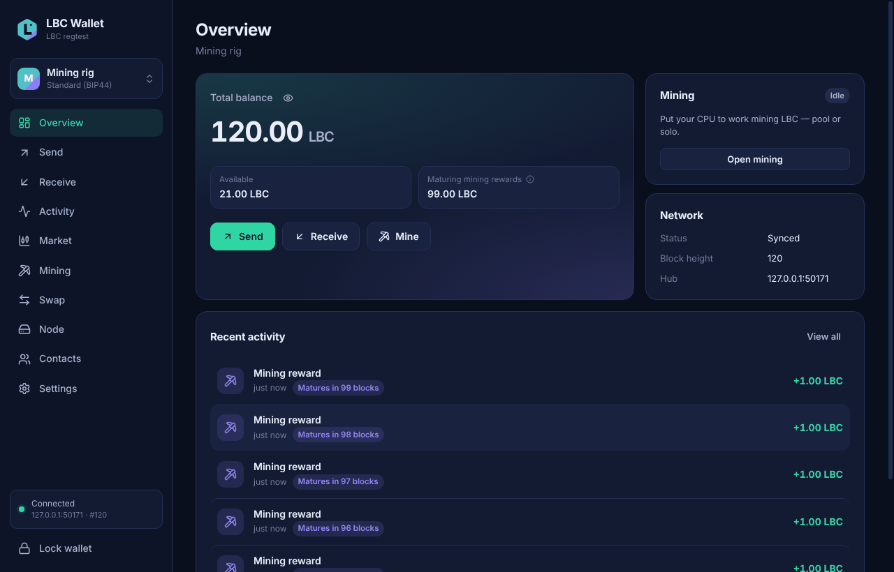
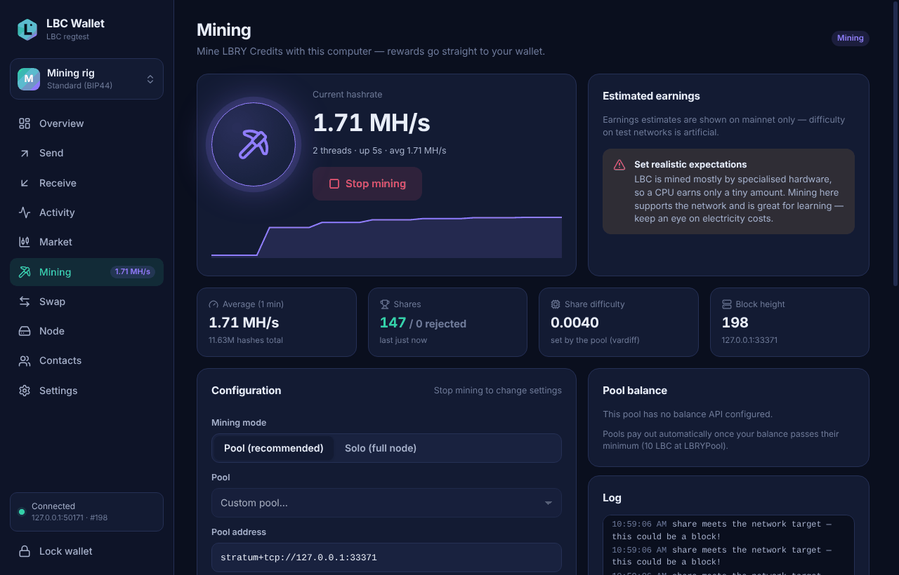
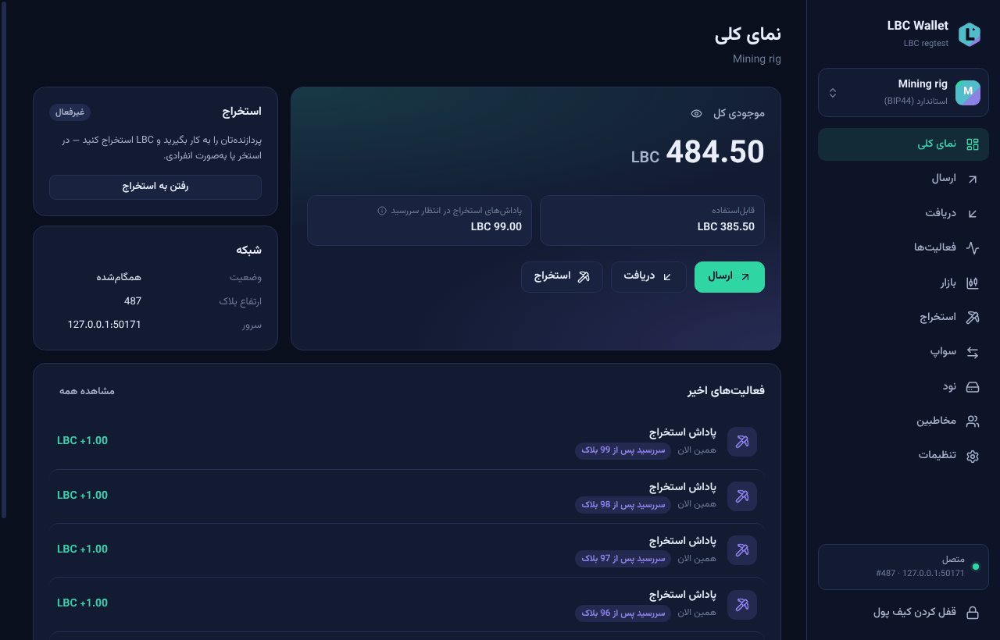

# LBC Wallet

**A free, non-custodial wallet for LBRY Credits (LBC) — with a built-in miner and a built-in
full node, like the Monero GUI.** Keep, send and receive LBC, mine it with your computer or
phone, buy and sell it for Bitcoin on a built-in **order board** with no exchange in between,
and run your own LBRY node. For **Windows, Mac, Linux and Android**, in **15 languages**.

> [!CAUTION]
> **Experimental, unaudited software — use it at your own risk.** No independent security audit
> has been done yet. It may contain bugs that lose money. The authors and contributors are **not
> responsible for any loss**. Keep your recovery phrase on paper, start with a small amount, and
> read the [full disclaimer](DISCLAIMER.md) before use. You must accept it when the app first
> starts.

## ⬇️ Download

**New to all this? Read the [step-by-step beginner's manual](docs/manual/README.md)** — it
explains, with pictures, how to install, create a wallet, receive, send and mine. No GitHub
knowledge needed ([PDF version](https://github.com/mnaghshvarian/lBC-wallet-with-mining-ability/raw/HEAD/docs/manual/LBC-Wallet-Manual.pdf)). Short guides: [فارسی](docs/manual/quickstart/fa.md) ·
[العربية](docs/manual/quickstart/ar.md) · [اردو](docs/manual/quickstart/ur.md) ·
[Français](docs/manual/quickstart/fr.md) · [Deutsch](docs/manual/quickstart/de.md) ·
[Español](docs/manual/quickstart/es.md) · [Português](docs/manual/quickstart/pt.md) ·
[Nederlands](docs/manual/quickstart/nl.md) · [Русский](docs/manual/quickstart/ru.md) ·
[简体中文](docs/manual/quickstart/zh-CN.md) · [日本語](docs/manual/quickstart/ja.md) ·
[한국어](docs/manual/quickstart/ko.md) · [ไทย](docs/manual/quickstart/th.md) ·
[हिन्दी](docs/manual/quickstart/hi.md) · [English](docs/manual/quickstart/en.md).

| Your device | Download (always the newest version) |
| --- | --- |
| **Windows** 10 / 11 | [**Installer** (LBC-Wallet-Setup-x64.exe)](https://github.com/mnaghshvarian/lBC-wallet-with-mining-ability/releases/latest/download/LBC-Wallet-Setup-x64.exe) · [portable .exe](https://github.com/mnaghshvarian/lBC-wallet-with-mining-ability/releases/latest/download/LBC-Wallet-Portable-x64.exe) |
| **Mac** with Apple chip (M1–M4) | [LBC-Wallet-mac-arm64.dmg](https://github.com/mnaghshvarian/lBC-wallet-with-mining-ability/releases/latest/download/LBC-Wallet-mac-arm64.dmg) |
| **Mac** with Intel chip | [LBC-Wallet-mac-x64.dmg](https://github.com/mnaghshvarian/lBC-wallet-with-mining-ability/releases/latest/download/LBC-Wallet-mac-x64.dmg) |
| **Ubuntu, Debian, Mint** | [lbc-wallet_amd64.deb](https://github.com/mnaghshvarian/lBC-wallet-with-mining-ability/releases/latest/download/lbc-wallet_amd64.deb) |
| **Fedora, openSUSE, RHEL** | [lbc-wallet.x86_64.rpm](https://github.com/mnaghshvarian/lBC-wallet-with-mining-ability/releases/latest/download/lbc-wallet.x86_64.rpm) |
| **Any Linux** | [LBC-Wallet-linux-x86_64.AppImage](https://github.com/mnaghshvarian/lBC-wallet-with-mining-ability/releases/latest/download/LBC-Wallet-linux-x86_64.AppImage) |
| Linux on ARM64 (e.g. Raspberry Pi 4/5) | [.deb](https://github.com/mnaghshvarian/lBC-wallet-with-mining-ability/releases/latest/download/lbc-wallet_arm64.deb) · [.rpm](https://github.com/mnaghshvarian/lBC-wallet-with-mining-ability/releases/latest/download/lbc-wallet.aarch64.rpm) · [AppImage](https://github.com/mnaghshvarian/lBC-wallet-with-mining-ability/releases/latest/download/LBC-Wallet-linux-arm64.AppImage) |
| **Android** 7+ | [LBC-Wallet-android.apk](https://github.com/mnaghshvarian/lBC-wallet-with-mining-ability/releases/latest/download/LBC-Wallet-android.apk) ([how to install an APK](docs/manual/README.md#7-install-on-android)) |

All files and their SHA-256 checksums are on the
[Releases page](https://github.com/mnaghshvarian/lBC-wallet-with-mining-ability/releases).
Builds are not code-signed yet, so Windows and macOS show a warning the first time — the
[manual](docs/manual/README.md) shows how to open the app safely.

## What it does

**Wallet** — your keys stay on your device, encrypted with your password (scrypt +
AES-256-GCM).

* Create a wallet with a 12/24-word recovery phrase, or restore one from **LBRY Desktop, Odysee**
  or any BIP39 wallet (the derivation is detected automatically); watch-only wallets from an
  `xpub`.
* Send and receive with QR codes, contacts, notes, a fee preview and a full review step;
  password on every send by default.
* **Tips and supports** received on LBRY are shown separately and can be unlocked in one click.
* Activity with filters, search and CSV export. Every confirmation is **SPV-verified** against
  a proof-of-work-valid block header — the wallet doesn't just trust the server.
* Auto-lock, several wallets, optional fiat prices, optional **Tor/SOCKS5**.

**Miner**

* Mine through a **pool** (LBRYPool preset, any LBRY Stratum pool) or **solo** with your own
  node. A WebAssembly SIMD implementation of LBRY's proof of work runs in a separate
  low-priority process.
* Pause on battery, mine only when the computer is idle, live hashrate, shares, pool balance and
  earnings estimate.
* **On Android phones too** (pool mining). It runs only while the app is on the screen and the
  phone is charging (you can allow battery mining). It pauses when the battery gets warm
  (40 °C) or the battery saver is on.
* **How much LBC is left to mine:** the reward now, the next reward drop and the last reward
  (around 2035), computed from the chain's own reward rule.

> **Be realistic:** LBC is mined mostly by specialized hardware, so a normal computer earns very
> little — often less than the electricity costs. See [docs/MINING.md](docs/MINING.md).

**Built-in full node** (computers) — like the Monero GUI's local node.

* Runs **lbcd**, LBRY's official node software, bundled unmodified (built from its verified
  release source).
* Choose **where the blockchain is stored** (about 150 GB; an external disk works), accept
  incoming connections to help the network, see sync progress, peers and disk use.
* When the node is ready, the wallet reads the chain from it instead of public servers, and solo
  mining uses it.

**Market: an order board for LBC ↔ Bitcoin** — see other people's offers to buy or sell LBC,
priced against the exchange price (MEXC), take one, or post your own. There is no exchange: offers
and encrypted trade messages travel through public **Nostr relays**, and a taken offer settles as
an atomic swap between the two wallets, which pass the swap codes along by themselves. Nobody holds
anyone's coins, there are no accounts and no fees. A separate warning must be accepted first.
Paying with USDT or Monero works in two steps (change them to Bitcoin first, for example in Trust
Wallet or Cake Wallet): see the [manual](docs/manual/README.md#23-paying-with-usdt-monero-or-other-coins).

**Swaps: LBC ↔ Bitcoin** — trade directly with another person, with no exchange and no
middleman. Atomic swaps with hash-time-locked contracts: either both of you get paid, or both
get your coins back after the lock time. The other side's contract is checked before anything
is locked. LBC payments are verified with SPV proofs, and Bitcoin payments are cross-checked by
two independent explorers. New and unaudited, so start small (from 20,000 sats, up to 0.05 BTC).

**Android app** — a complete wallet on its own (no computer needed), with the same screens.
Pool mining while charging, screenshots blocked on secret screens, no cloud backups of wallet
files.

**15 languages** — English, فارسی, العربية, اردو, हिन्दी, Français, Deutsch, Español, Português,
Nederlands, Русский, 简体中文, 日本語, 한국어, ไทย (right-to-left layouts included).

| Mining | Built-in node | Persian (right to left) | Android |
| --- | --- | --- | --- |
|  |  |  |  |

## Documentation

* [Beginner's manual](docs/manual/README.md) — install, create, receive, send, mine, node, FAQ
* [Disclaimer](DISCLAIMER.md) — please read
* [Mining guide](docs/MINING.md) — pools, solo mining, expectations, troubleshooting
* [Security model](docs/SECURITY.md) — what protects your funds and privacy; how to report a vulnerability
* [Architecture](docs/ARCHITECTURE.md) — how the shared core, services, apps and miner fit together
* [Building from source](docs/BUILDING.md) — development, tests, packaging, Android, releases
* [Testing on the real network](docs/TESTING-MAINNET.md) — what CI checks on mainnet, the
  real-payment test, and a checklist for testers
* [Roadmap](docs/ROADMAP.md) — next: a decentralized (P2Pool-style) mining pool in the wallet,
  proof of funds and reputation for Market offers, more coins
* [Fork, rename, privacy or RandomX?](docs/LBC-FUTURE.md) — questions about LBC's future, and the
  SEC's March 2026 interpretation naming LBC a digital commodity

## How it is tested

Every push runs, on GitHub's servers:

* unit tests with LBRY's own test vectors (seeds, keys, addresses, signatures, proof of work),
  and translation checks for all 15 languages;
* end-to-end tests against a real `lbcd` on a private test network: payments, tips, restore,
  SPV proofs over the hub protocol, blocks mined solo and through a Stratum pool;
* **atomic swaps between two wallets on a real `lbcd` and a real Bitcoin node (`btcd`)**: a
  completed swap, a refund on each side, and a dishonest contract that is refused;
* **the Market**: one wallet posts an offer on a local Nostr relay, another takes part of it, and
  the two wallets run the whole swap between themselves; takes that do not fit, and a take that
  nobody answers, end without anything locked;
* the real desktop app driven by a robot (development build and the packaged, locked-down
  build): disclaimer, restore, create with backup check, send, confirm, pool mining, **starting
  the built-in node, syncing it and solo-mining through it**, settings, Persian and phone layouts;
* the **installed** Windows and macOS apps: the installer is run silently, then the whole UI test
  runs on the installed app, followed by the privacy audit and an uninstall that keeps wallet
  files;
* the Android app in an Android emulator: restore, receive, send, confirm, screenshot blocking,
  and **mining on the phone** (shares accepted, pause when unplugged);
* a network audit (no telemetry or unexpected connections);
* a **mainnet check** (also weekly): public LBRY servers, proof-of-work headers, real
  transactions verified against block headers, a login to LBRYPool, the Bitcoin explorers used
  by swaps, the built-in node finding peers and syncing mainnet, and **the installed Windows
  app opening a wallet on the real network**. Nothing is mined in CI. A real payment (through
  the wallet code and through the Windows app's Send screen) runs when started by hand with a
  small test wallet; see [TESTING-MAINNET.md](docs/TESTING-MAINNET.md).

## License

[MIT](LICENSE). LBC Wallet is an independent community project and is **not affiliated** with
LBRY Inc., Odysee, the LBRY Foundation, or any exchange or pool. Provided "as is", without
warranty of any kind — see the [disclaimer](DISCLAIMER.md).
