# LBC Wallet — the complete beginner's manual

This manual explains everything step by step, in plain words. You do **not** need to know
anything about GitHub, programming or the command line. If a word is new to you, look it up in
the [glossary](#glossary) at the end. You can also
[download this manual as a PDF](https://github.com/mnaghshvarian/lBC-wallet-with-mining-ability/raw/HEAD/docs/manual/LBC-Wallet-Manual.pdf)
to read offline or print. Prefer watching? The [video manual](videos.md) shows the same steps in
short narrated videos, one per chapter.

**Other languages:** short quick-start guides are available in
[فارسی](quickstart/fa.md) · [العربية](quickstart/ar.md) · [اردو](quickstart/ur.md) ·
[Français](quickstart/fr.md) · [Deutsch](quickstart/de.md) · [Español](quickstart/es.md) ·
[Português](quickstart/pt.md) · [Nederlands](quickstart/nl.md) · [Русский](quickstart/ru.md) ·
[简体中文](quickstart/zh-CN.md) · [日本語](quickstart/ja.md) · [한국어](quickstart/ko.md) ·
[ไทย](quickstart/th.md) · [हिन्दी](quickstart/hi.md) · [English](quickstart/en.md). The app
itself is available in all of these 15 languages.

> [!WARNING]
> **Please read this first.** LBC Wallet is free, experimental software made by volunteers.
> **It has not been audited** by independent security experts, and it may contain mistakes
> that lose money. **You use it at your own risk** — the authors are not responsible for any
> loss. Start with a small amount you can afford to lose. Read the full
> [disclaimer](../../DISCLAIMER.md).

---

## Contents

1. [What is LBC Wallet?](#1-what-is-lbc-wallet)
2. [Five safety rules](#2-five-safety-rules)
3. [Download the right file](#3-download-the-right-file)
4. [Install on Windows](#4-install-on-windows)
5. [Install on a Mac](#5-install-on-a-mac)
6. [Install on Linux](#6-install-on-linux)
7. [Install on Android](#7-install-on-android)
8. [First start: the disclaimer and choosing your language](#8-first-start)
9. [Create a new wallet](#9-create-a-new-wallet)
10. [Restore a wallet you already have](#10-restore-a-wallet-you-already-have)
11. [Receive LBC](#11-receive-lbc)
12. [Send LBC](#12-send-lbc)
13. [Your activity (transaction history)](#13-your-activity)
14. [Mine LBC](#14-mine-lbc)
15. [Run your own node](#15-run-your-own-node)
16. [Settings](#16-settings)
17. [Backups, new computers and new phones](#17-backups-new-computers-and-new-phones)
18. [Updating the app](#18-updating-the-app)
19. [Problems and solutions](#19-problems-and-solutions)
20. [Check that your download is genuine (optional)](#20-check-that-your-download-is-genuine-optional)
21. [Buy, sell or swap LBC](#21-buy-sell-or-swap-lbc)
22. [Trade on the Market](#22-trade-on-the-market)
23. [Paying with USDT, Monero or other coins](#23-paying-with-usdt-monero-or-other-coins)
24. [Glossary](#glossary)

---

## 1. What is LBC Wallet?

**LBC** (LBRY Credits) is the cryptocurrency of the LBRY network, the technology behind
[Odysee](https://odysee.com). LBC Wallet is an app where you can:

* **keep** your LBC safely on your own computer or phone;
* **receive** LBC from other people, exchanges and mining pools;
* **send** LBC to anyone;
* **mine** LBC with your computer (like in the Monero GUI wallet) or your Android phone;
* **buy and sell** LBC for Bitcoin with other people on the **Market**, an order board with no
  exchange in between, or **swap** directly with someone you know;
* **run your own LBRY node** (a full copy of the LBC blockchain), so you don't depend on anyone
  else's servers;
* see and **unlock tips and supports** you received on LBRY / Odysee.

It works on **Windows, Mac, Linux** and **Android** phones, in **15 languages**.

**"Non-custodial"** means *you* hold your money, not a company. That is good: nobody can freeze
or take your coins. It also means **nobody can help you if you lose your recovery phrase**
(see the safety rules below).

---

## 2. Five safety rules

1. **Your recovery phrase is your money.** When you create a wallet, the app shows 12 (or 24)
   words. Anyone who has these words can take your LBC. **Write them on paper**, in order, and
   keep the paper somewhere safe. Never photograph them, never type them into a website or a
   chat, never store them in email or cloud notes.
2. **Nobody legitimate will ever ask for your recovery phrase** — not the developers, not
   "support", not an exchange. Anyone who asks is trying to steal from you.
3. **Download the app only from the official page:**
   <https://github.com/mnaghshvarian/lBC-wallet-with-mining-ability/releases>.
   Copies from other places may be changed to steal coins.
4. **Check the address before you send.** Payments cannot be reversed. Compare at least the
   first and last 6 characters.
5. **Start small.** This software is new and unaudited. Try it with a small amount first.

---

## 3. Download the right file

All downloads are on the **[Releases page](https://github.com/mnaghshvarian/lBC-wallet-with-mining-ability/releases/latest)**.
Open it, scroll down to the section called **Assets**, and click the file for your device.
Or use these direct links (they always give you the newest version):

| Your device | File to download |
| --- | --- |
| **Windows** 10 or 11 (almost every Windows PC) | [LBC-Wallet-Setup-x64.exe](https://github.com/mnaghshvarian/lBC-wallet-with-mining-ability/releases/latest/download/LBC-Wallet-Setup-x64.exe) (installer) |
| Windows, without installing (USB stick) | [LBC-Wallet-Portable-x64.exe](https://github.com/mnaghshvarian/lBC-wallet-with-mining-ability/releases/latest/download/LBC-Wallet-Portable-x64.exe) |
| **Mac with Apple chip** (M1, M2, M3, M4…) | [LBC-Wallet-mac-arm64.dmg](https://github.com/mnaghshvarian/lBC-wallet-with-mining-ability/releases/latest/download/LBC-Wallet-mac-arm64.dmg) |
| **Mac with Intel chip** (older Macs) | [LBC-Wallet-mac-x64.dmg](https://github.com/mnaghshvarian/lBC-wallet-with-mining-ability/releases/latest/download/LBC-Wallet-mac-x64.dmg) |
| **Ubuntu, Debian, Linux Mint, Pop!_OS, Zorin, elementary** | [lbc-wallet_amd64.deb](https://github.com/mnaghshvarian/lBC-wallet-with-mining-ability/releases/latest/download/lbc-wallet_amd64.deb) |
| **Fedora, openSUSE, RHEL, Rocky, AlmaLinux** | [lbc-wallet.x86_64.rpm](https://github.com/mnaghshvarian/lBC-wallet-with-mining-ability/releases/latest/download/lbc-wallet.x86_64.rpm) |
| **Any other Linux** (Arch, Manjaro, Gentoo, Void…) | [LBC-Wallet-linux-x86_64.AppImage](https://github.com/mnaghshvarian/lBC-wallet-with-mining-ability/releases/latest/download/LBC-Wallet-linux-x86_64.AppImage) |
| Linux on ARM (Raspberry Pi 4/5 with 64-bit OS) | [lbc-wallet_arm64.deb](https://github.com/mnaghshvarian/lBC-wallet-with-mining-ability/releases/latest/download/lbc-wallet_arm64.deb), [lbc-wallet.aarch64.rpm](https://github.com/mnaghshvarian/lBC-wallet-with-mining-ability/releases/latest/download/lbc-wallet.aarch64.rpm) or [LBC-Wallet-linux-arm64.AppImage](https://github.com/mnaghshvarian/lBC-wallet-with-mining-ability/releases/latest/download/LBC-Wallet-linux-arm64.AppImage) |
| **Android** phone or tablet (Android 7 or newer) | [LBC-Wallet-android.apk](https://github.com/mnaghshvarian/lBC-wallet-with-mining-ability/releases/latest/download/LBC-Wallet-android.apk) |

**Not sure which Mac you have?** Click the Apple menu  (top-left corner) → **About This Mac**.
If it says **Chip: Apple M…**, take the *Apple chip* file. If it says **Processor: Intel**, take
the *Intel* file.

**Not sure which Linux you have?** If your system has an "Ubuntu Software" or "Software Manager"
app with an orange or green icon, it is probably Ubuntu/Mint: take the `.deb`. If it is Fedora,
take the `.rpm`. When in doubt, the `.AppImage` works almost everywhere.

> [!NOTE]
> The download is free. If any website asks you to pay for LBC Wallet, it is a scam.

---

## 4. Install on Windows

1. **Download** `LBC-Wallet-Setup-x64.exe` (see the table above). Your browser saves it in the
   **Downloads** folder.
2. **Double-click** the file to start it.
3. Windows may show a blue window: **"Windows protected your PC"**. This appears because the app
   is new and not signed with a paid Microsoft certificate — not because something is wrong.
   If you downloaded it from the official page, click **More info**, then **Run anyway**.
4. The installer shows the **disclaimer and license**. Read it, then click **I Agree**.
5. Choose **Only for me** (recommended) and click **Next**.
6. Keep the suggested folder and click **Install**. Wait a few seconds.
7. Click **Finish**. LBC Wallet starts. Next time, open it from the **Start menu** or the
   **LBC Wallet** icon on your desktop.

**Portable version:** `LBC-Wallet-Portable-x64.exe` runs without installing — double-click it.
Your wallets are still stored in your user folder (see [section 17](#17-backups-new-computers-and-new-phones)).

**Antivirus warning?** Some antivirus programs warn about *any* program that can mine
cryptocurrency, because criminals hide miners in other software. LBC Wallet mines only when *you*
press **Start mining**. If you are worried, compare the file's fingerprint with the official one
([section 20](#20-check-that-your-download-is-genuine-optional)).

**To uninstall:** Windows Settings → Apps → LBC Wallet → Uninstall. Your wallet files are kept;
delete them yourself only if you have your recovery phrase.

---

## 5. Install on a Mac

1. **Download** the right `.dmg` file (Apple chip or Intel — see [section 3](#3-download-the-right-file)).
2. **Double-click** the downloaded `.dmg` file. A window with the **disclaimer and license**
   appears: read it and click **Agree**.
3. A window opens showing the **LBC Wallet** icon and the **Applications** folder. **Drag the
   LBC Wallet icon onto the Applications folder.**
4. Open your **Applications** folder (Finder → Applications) and **double-click LBC Wallet**.
5. The first time, macOS says the app **"Not Opened"** or **"cannot be opened because Apple
   cannot check it for malicious software"**. This is because the app is not notarized by Apple
   (that needs a paid Apple account). Click **Done** (not "Move to Trash"), then:
   1. Open **System Settings** (Apple menu  → System Settings).
   2. Click **Privacy & Security** on the left.
   3. Scroll down. You will see *"LBC Wallet" was blocked to protect your Mac.* Click
      **Open Anyway**.
   4. Enter your Mac password (or use Touch ID) and click **Open**.
6. From now on, LBC Wallet opens normally. You can eject the disk image (the drive icon called
   "LBC Wallet") in Finder.

**To uninstall:** drag **LBC Wallet** from Applications to the Trash.

---

## 6. Install on Linux

### Ubuntu, Debian, Linux Mint and similar (`.deb`)

**The easy way:** double-click `lbc-wallet_amd64.deb` in your Downloads folder. Your software
center opens. Click **Install** and enter your password.

**With the terminal** (open it with **Ctrl + Alt + T**):

```bash
cd ~/Downloads
sudo apt install ./lbc-wallet_amd64.deb
```

Then open **LBC Wallet** from your applications menu.

### Fedora, openSUSE, RHEL and similar (`.rpm`)

Double-click the `.rpm` file to open it in **Software**, then click **Install**. Or in the terminal:

```bash
cd ~/Downloads
sudo dnf install ./lbc-wallet.x86_64.rpm      # Fedora, RHEL, Rocky, AlmaLinux
sudo zypper install ./lbc-wallet.x86_64.rpm   # openSUSE
```

### Any Linux: the AppImage

An AppImage is one file that runs without installing.

1. Right-click `LBC-Wallet-linux-x86_64.AppImage` → **Properties** → **Permissions** → tick
   **Allow executing file as program** (or in the terminal:
   `chmod +x ~/Downloads/LBC-Wallet-linux-x86_64.AppImage`).
2. Double-click it.

If it does not start, your system may need the **FUSE** library:

```bash
sudo apt install libfuse2t64      # Ubuntu 24.04 and newer (libfuse2 on older versions)
sudo dnf install fuse fuse-libs   # Fedora
sudo pacman -S fuse2              # Arch, Manjaro
```

> [!TIP]
> On **Ubuntu 24.04 and newer**, please use the `.deb` instead of the AppImage. Ubuntu limits a
> security feature (the "sandbox") that the AppImage needs, while the `.deb` sets it up for you.

### Raspberry Pi and other ARM computers

Use the `arm64` files (`lbc-wallet_arm64.deb`, `lbc-wallet.aarch64.rpm` or
`LBC-Wallet-linux-arm64.AppImage`). You need a **64-bit** operating system. Mining on a Raspberry
Pi earns almost nothing, but the wallet and the node work.

**To uninstall:** `sudo apt remove lbc-wallet` (deb), `sudo dnf remove lbc-wallet` (rpm), or
delete the AppImage file.

---

## 7. Install on Android

The Android app is not in the Google Play Store (Google does not allow apps like this one to be
published easily, and we want to keep it free and independent). You install the **APK file**
directly — this is called *sideloading* and is safe when the file comes from the official page.

1. On your phone, open this page in **Chrome** (or your usual browser) and tap the link:
   **[LBC-Wallet-android.apk](https://github.com/mnaghshvarian/lBC-wallet-with-mining-ability/releases/latest/download/LBC-Wallet-android.apk)**.
2. Chrome may warn *"This type of file can harm your device"*. Tap **Download anyway**.
3. When the download finishes, tap **Open** (or open the **Downloads** app / **Files** app and
   tap `LBC-Wallet-android.apk`).
4. Android says *"For your security, your phone is not allowed to install unknown apps from
   this source"*. Tap **Settings**, switch on **Allow from this source**, then go **back**.
5. Tap **Install**.
6. **Google Play Protect** may say the app is from an *unknown developer* or *not scanned*. Tap
   **More details** → **Install anyway**. (If it offers to *scan the app*, you can let it.)
7. Tap **Open**. The app icon (a blue-green hexagon with an "L") is now in your app list.

After installing, you can switch **Allow from this source** off again for your browser
(Settings → Apps → Chrome → Install unknown apps).

**What the phone app can do:** it is a complete wallet on its own. You don't need a computer.
You can create or restore wallets, receive, send and swap, and **mine through a pool** while the
phone is charging (see [Mining on your phone](#mining-on-your-phone)). Only the built-in node is
missing, because a phone has neither the space nor the battery for the whole blockchain.

| Your wallet | Receive | Check before sending | In Persian |
| --- | --- | --- | --- |
| 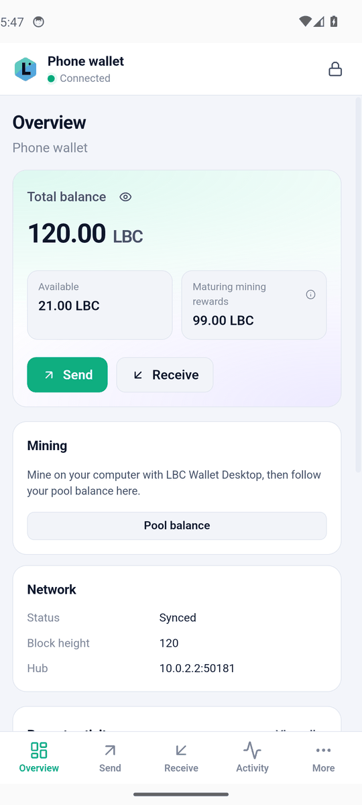 | 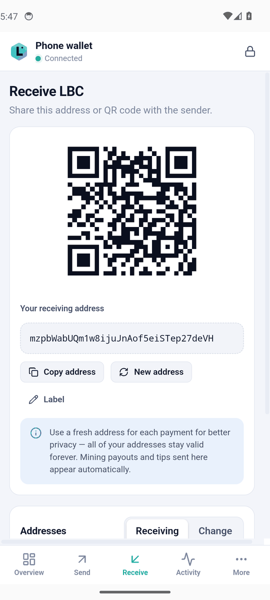 | 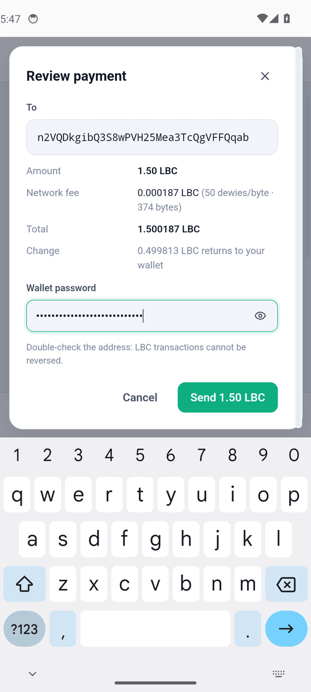 | 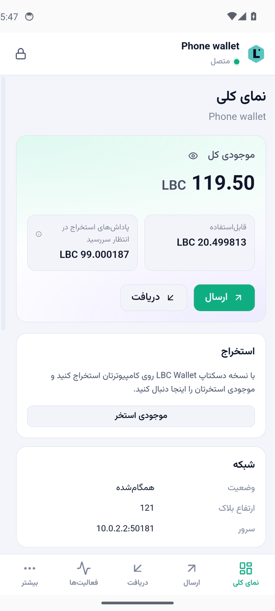 |

*(Pictures from the real app on an Android 14 phone emulator, on a test network.)*

> [!IMPORTANT]
> **Updating the Android app:** install the newer APK the same way; Android keeps your wallets.
> If Android says *"App not installed as package conflicts with an existing package"*, the new
> file was signed with a different key (this can happen with test versions). Then you must
> uninstall the old app first — **which deletes the wallets on the phone**, so make sure you have
> your recovery phrase written down before doing that.

---

## 8. First start

### The disclaimer

The very first time you open LBC Wallet, it shows **"Read this before you start"**. It explains
the risks in plain words. Read it, tick the **three boxes** to confirm you understand, and click
**I agree — continue**. If you do not agree, click **Quit**.

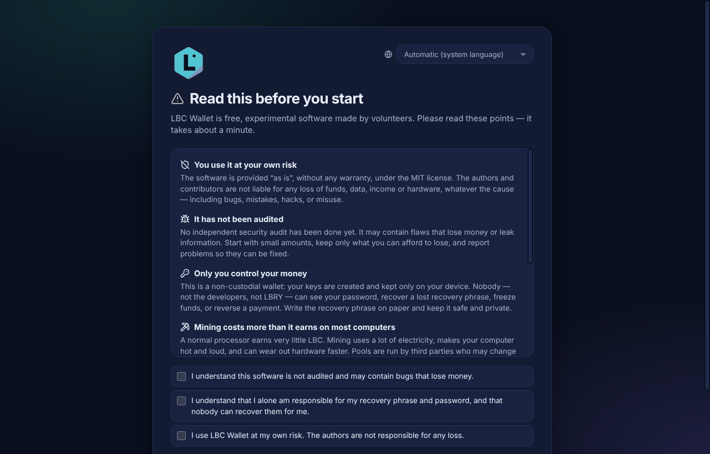

### Choosing your language

The app starts in your computer's language if it is one of the 15 supported languages.
To change it, use the **globe** menu at the top right of the first screens, or later
**Settings → General → Language**.

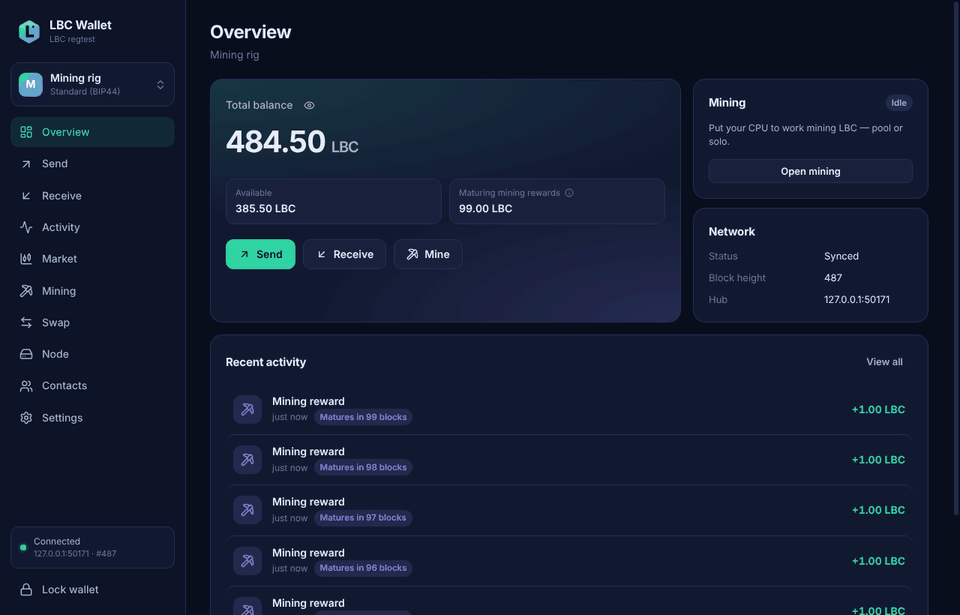

---

## 9. Create a new wallet

Use this if you are **new to LBC** or want a separate wallet.

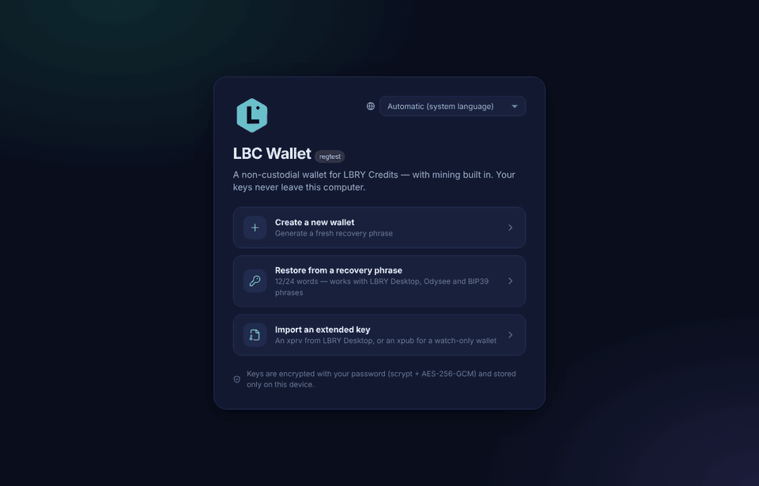

1. On the welcome screen, click **Create a new wallet**.
2. **Name** your wallet (for example "My savings") and choose a **password**.
   * The password protects the wallet *on this device* — it is needed to open the wallet and to
     send money.
   * Use at least 8 characters; a long sentence that you can remember is best.
   * If you forget the password, you can still restore the wallet with your recovery phrase.
3. Click **Continue**. Click **Reveal recovery phrase**. Take a **pen and paper** and write the
   words **in order**, with their numbers. Check every word twice.

   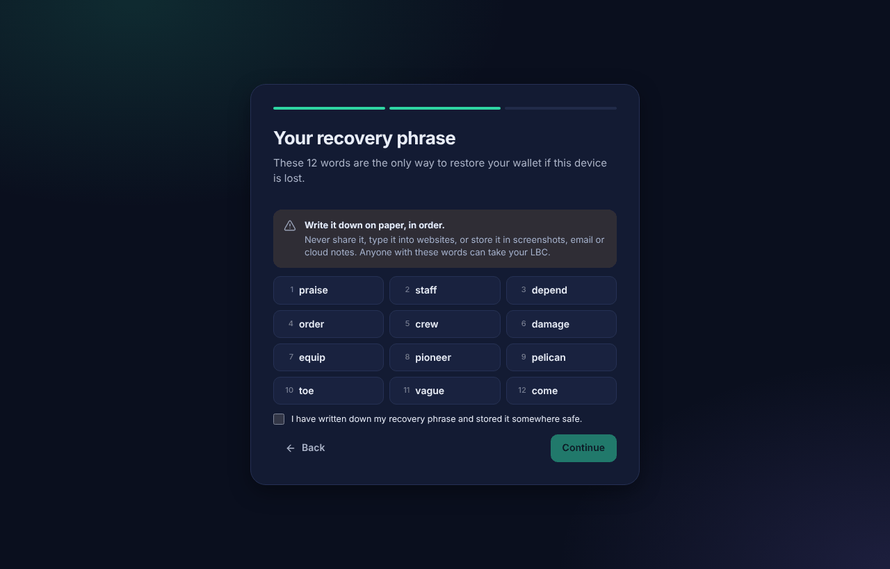

   *The words in this picture come from a test. Never use a phrase you did not create yourself:
   anyone who knows it can take the coins.*

4. Tick **"I have written down my recovery phrase…"** and click **Continue**.
5. The app asks for **three of your words** (for example word #3, #7 and #11) to make sure your
   paper is correct. Type them and click **Create wallet**.

   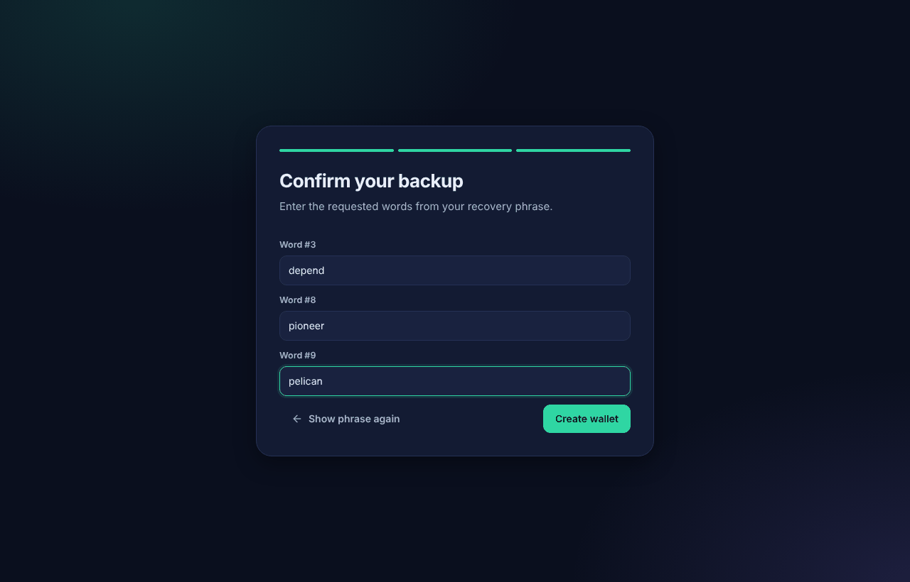

6. Done! You see the **Overview** with a balance of 0 LBC.

**Advanced options** (you can ignore them): a 24-word phrase instead of 12, and
"LBRY Desktop compatible" addresses if you also want to use this phrase in the old LBRY Desktop
app.

---

## 10. Restore a wallet you already have

Use this if you already have a recovery phrase — from this app, from **LBRY Desktop**, from
**Odysee**, or from any wallet that uses standard 12/24-word (BIP39) phrases.


1. On the welcome screen, click **Restore from a recovery phrase**.
2. Type your words, separated by spaces (or paste them). The app checks the words as you type:
   it tells you if a word is misspelled.

   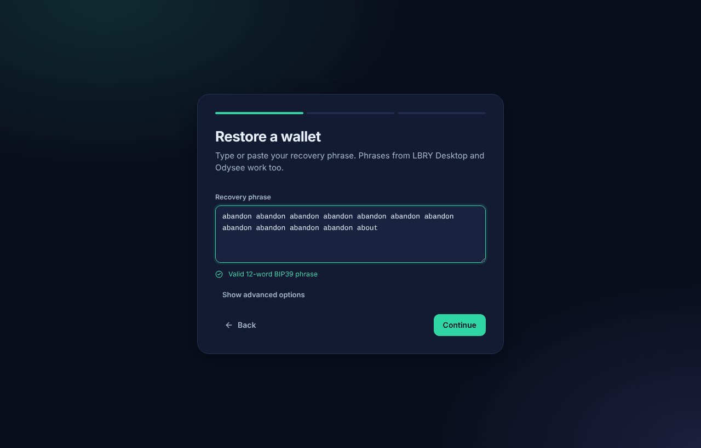

3. Click **Continue**. The app looks on the LBRY network for your money with each method LBRY
   wallets have used, and picks the right one automatically (**"Found your wallet"**).

   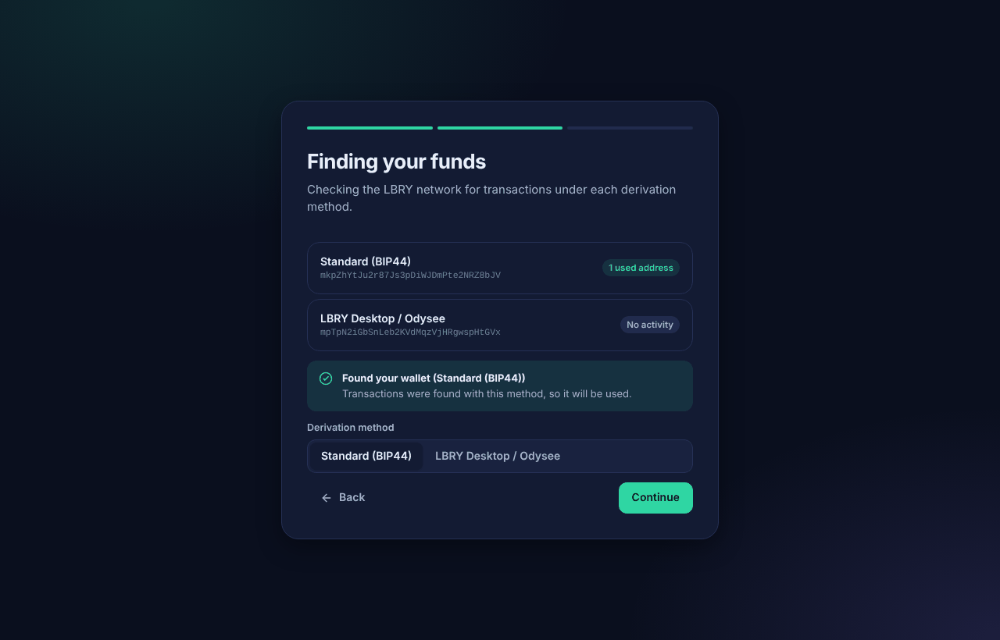

4. Click **Continue**, give the wallet a name and a password, and click **Restore wallet**.
5. Your balance and history appear after a few seconds to a minute.

**Importing a key instead:** if you only have an **xprv** key from LBRY Desktop's `wallet.json`,
choose **Import an extended key** on the welcome screen. An **xpub** key creates a *watch-only*
wallet: it shows the balance (handy for a mining computer) but cannot send.

---

## 11. Receive LBC

1. Click **Receive** (on a phone: the **Receive** button at the bottom).
2. You see **your receiving address** (a long code starting with `b`) and a **QR code**.
3. Give the address to the person, exchange or pool that sends you LBC:
   * click **Copy address** and paste it into their website or message; or
   * let them scan the QR code with their phone.
4. When the payment arrives, a message pops up and it appears on the **Overview** and in
   **Activity**. It is *pending* at first and *confirmed* after the next block (about 2.5 minutes).

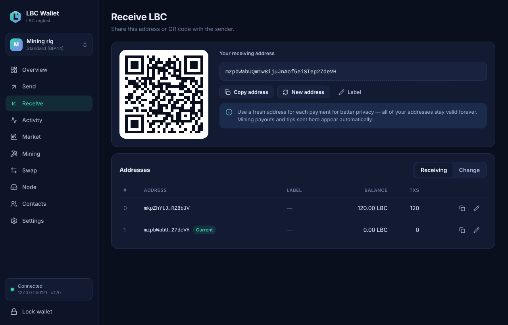

**New address:** for more privacy you can click **New address** to use a fresh address for
each payment. All your addresses keep working forever.

> The screenshots in this manual come from the app's automatic tests, which run on a private
> test network. That is why the addresses in the pictures start with `m` or `n`, and the
> amounts are test money. **Real LBC addresses start with `b`.**

---

## 12. Send LBC

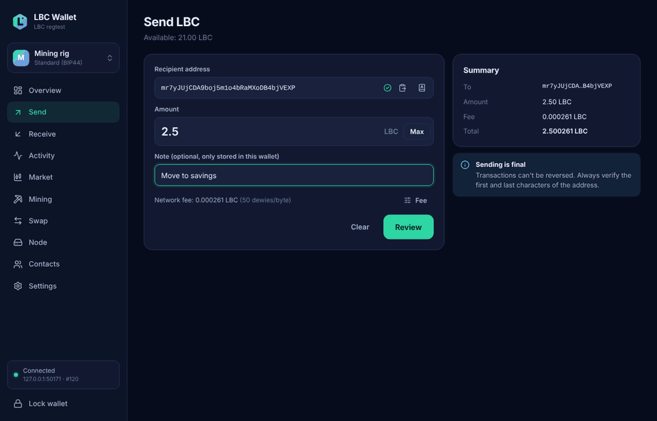

1. Click **Send**.
2. **Recipient address:** paste the address you want to pay (the clipboard button pastes it for
   you), or pick a saved contact with the address-book button. A green check mark appears when
   the address is valid.
3. **Amount:** type how many LBC to send. **Max** sends everything (minus the fee).
4. **Note** (optional): a private note for yourself, for example "Rent".
5. Check the **network fee** shown under the amount. The normal fee is tiny (a fraction of a cent).
6. Click **Review**. Check the address and the amount **very carefully**.

   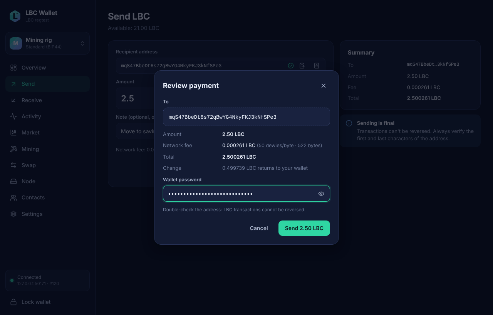

7. Enter your **wallet password** and click **Send**.
8. **"Transaction sent"** — done. It confirms within a few minutes. Click **View in explorer**
   if you want to see it on the public LBRY block explorer.

> [!CAUTION]
> Payments are **final**. If you send to a wrong address, nobody can get the money back.

**Contacts:** on the **Contacts** page you can save addresses you pay often.

---

## 13. Your activity

**Activity** lists every payment. Use the filters (**Received**, **Sent**, **Mining**, **Tips &
claims**) and the search box. Click a payment to see its details: date, status, fee, block and
transaction ID.

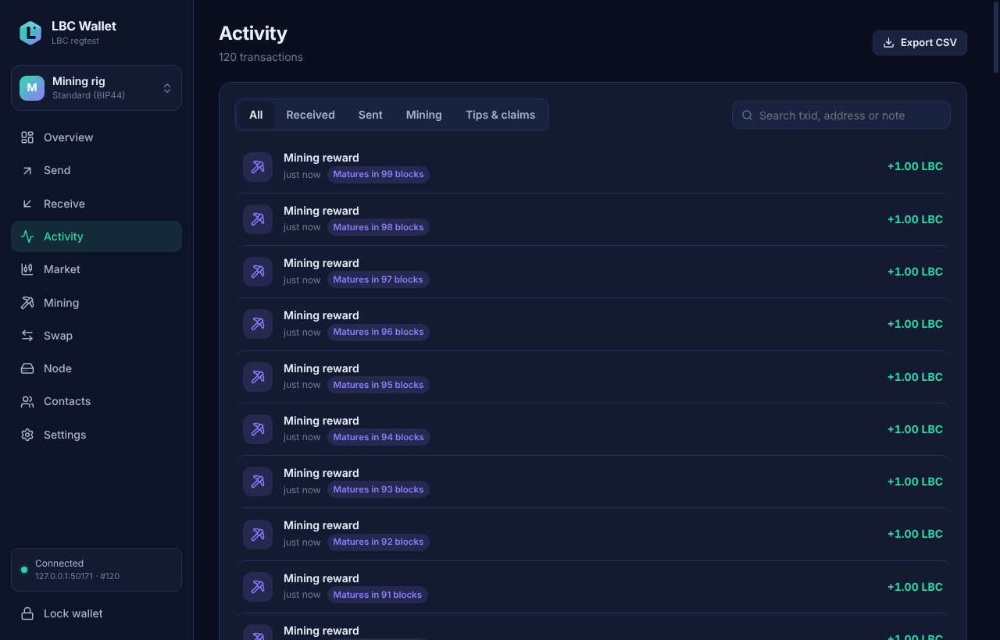

* **Pending** — waiting for its first confirmation.
* **Matures in N blocks** — a mining reward. Rewards can be spent after 100 confirmations
  (about 4 hours).
* **Verified** — the wallet checked mathematically that the payment is really in the blockchain
  (it does not just trust the server).

**Export CSV** saves your history as a spreadsheet file (for your records or taxes).

---

## 14. Mine LBC

Mining means using your computer's processor to help secure the LBC network. In return you can
earn a little LBC.

> [!IMPORTANT]
> **Be realistic.** LBC is mined mostly by specialised machines, so a normal computer earns a
> **very small** amount — often less than the electricity costs. Mining makes your computer hot
> and loud. Mine for fun and to support the network, not to get rich. Never mine on a computer
> that is not yours (work, school, cloud servers).

### Mining with a pool (recommended)

A **pool** combines the power of many miners and pays everyone small amounts regularly.

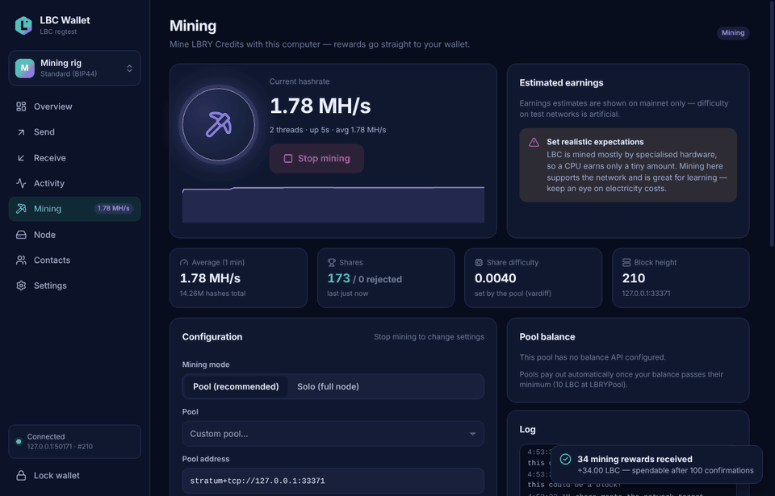

1. Open a wallet, then click **Mining**.
2. The **Mining mode** is **Pool (recommended)** and the pool is **LBRYPool** (lbrypool.net).
   You don't need an account: the pool pays to your wallet's address automatically.
3. Choose how many **CPU threads** to use (leave one or two free so your computer stays fast).
4. Click **Start mining**. After a few seconds you see your **hashrate** (speed) and
   **accepted shares** (your work counted by the pool).
5. The pool pays you automatically once your balance there passes its minimum (10 LBC at
   LBRYPool). The **Pool balance** box shows what the pool owes you.
6. Click **Stop mining** whenever you want.

**Useful options:**

* **Low priority** — mining gives way to anything else you do (on by default).
* **Pause on battery** — stops mining when a laptop is unplugged (on by default).
* **Only when idle** — mines only when you haven't touched the keyboard or mouse for a few
  minutes, and stops the moment you come back.

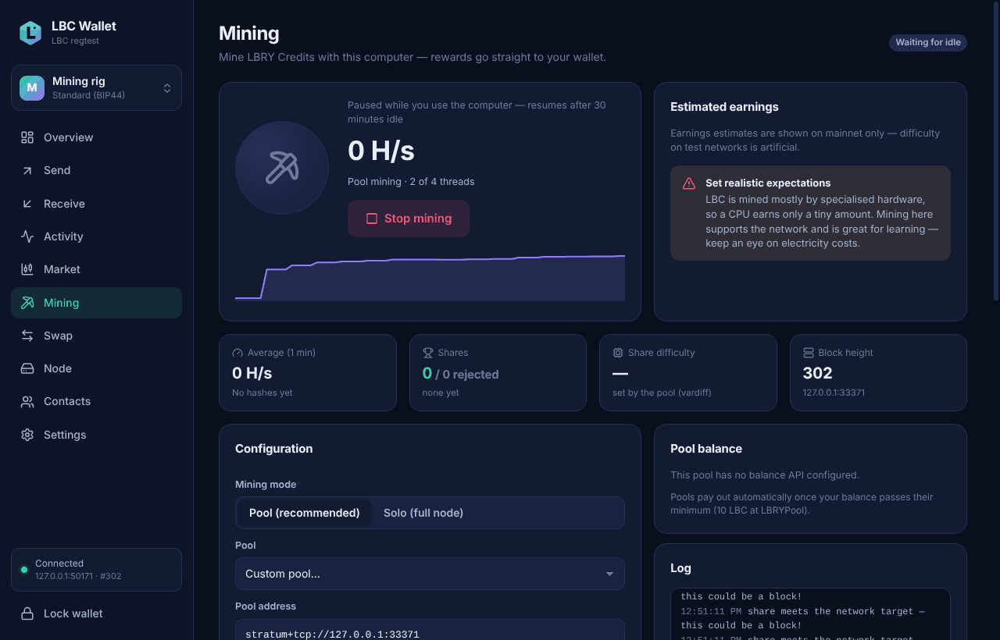

* **Payout address** — by default your wallet's address. You can enter another one, for
  example your phone wallet's address.

### Solo mining (with your own node)

**Solo** means you mine alone. If you find a block, you get the **whole block reward** — but with
a normal computer that may take years. Solo mining needs a full node:

1. Start the built-in node ([section 15](#15-run-your-own-node)) and wait until it is ready
   (100 %).
2. On the **Mining** page choose **Solo (full node)**. You see *"Using the built-in node — ready."*
3. Click **Start mining**.

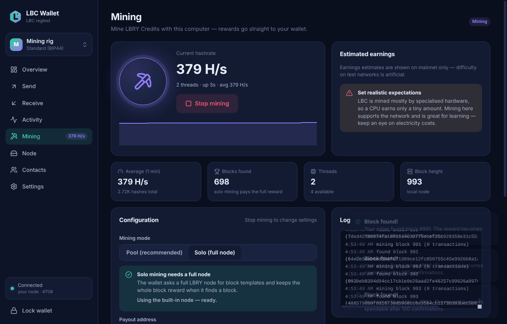

### Mining on your phone

The Android app mines through a pool too. A phone is much slower than a computer and earns even
less, so see it as a way to take part, not to earn. To protect your phone, the app mines only
when it is safe:

* **Only while LBC Wallet is on the screen.** The screen stays on while it mines. If you switch
  to another app or lock the phone, mining pauses, and it resumes when you come back.
* **Only while charging**, unless you switch *Only while charging* off. Even then it stops when
  the battery is below 30 %.
* It pauses when the **battery reaches 40 °C** and resumes below 37 °C. It also pauses when
  Android says the phone is getting hot, and while **battery saver** is on.

1. Open **More → Mining** with your wallet unlocked.
2. Plug in the charger and tap **Start mining**.
3. Leave the phone on a table with the app open: out of the sun, ideally out of its case.

| Mining on a phone | Paused until the charger is plugged in |
| --- | --- |
| 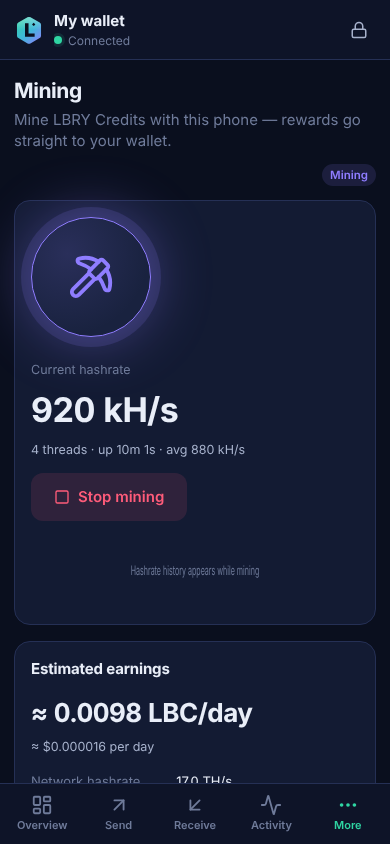 | 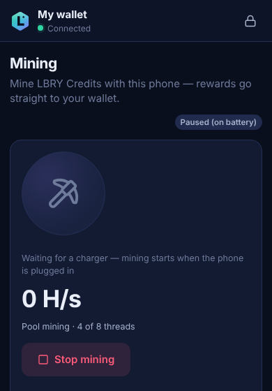 |

Solo mining and *Only when idle* are only on computers. Long mining sessions wear a phone's
battery faster, so don't leave an old phone mining unattended for days.

### How much LBC is left to mine?

The **LBC supply** card on the Mining page answers this from the current block. It uses the same
reward rule every LBRY node checks:

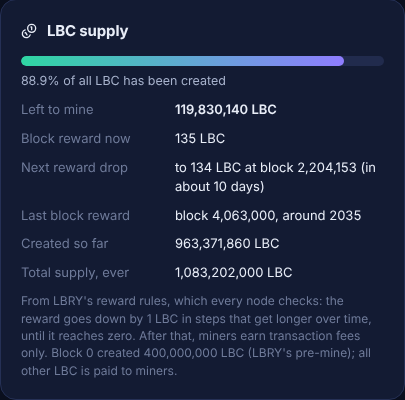

* **Total, ever: 1,083,202,000 LBC.** Block 0 created 400,000,000 LBC, which was LBRY's own
  pre-mine. Everything else is paid to miners, block by block.
* **Created so far:** about **963.4 million** LBC (October 2026). **About 119.8 million LBC**
  are left to mine.
* **The reward now is 135 LBC per block** (a block every 2.5 minutes). It goes down by 1 LBC in
  steps that get slowly longer. The next step, to 134 LBC, is at block 2,204,153, about 20 days
  after the previous one.
* **The last block reward** is paid at block 4,063,000, **around 2035**. After that, miners earn
  only transaction fees.

---

## 15. Run your own node

### Do I need to download the blockchain?

**No.** Without a node, LBC Wallet reads the blockchain through public LBRY servers (see
[Which servers does the wallet use?](#which-servers-does-the-wallet-use) below) and downloads
only what concerns your wallet: a few megabytes. It still checks every payment it shows against
the blocks' proof of work, so a server cannot invent payments. This is how most people use it,
and how the Android app always works.

The LBC blockchain is about **100 GB** today (about 150 GB with the indexes the wallet needs),
not 2 TB. You only need it if you want the extra privacy and independence of your own node, want
to help the network, or want to solo mine.

### What a node is

A **node** is a program that keeps a full copy of the LBC blockchain, checks every block itself
and shares the blocks with other nodes. Running one is like Monero GUI's *local node*:

* your wallet no longer depends on public servers (more privacy and independence);
* you help keep the LBRY network healthy;
* you can **solo mine**.

LBC Wallet includes **lbcd**, LBRY's official node software, unchanged.

**What you need:**

* about **150 GB** of free disk space (an external disk works);
* **8 GB** of memory (RAM) is recommended;
* time: the first download takes **one to three days**, depending on your internet and disk.
  You can keep using the wallet meanwhile — it uses public servers until the node is ready.

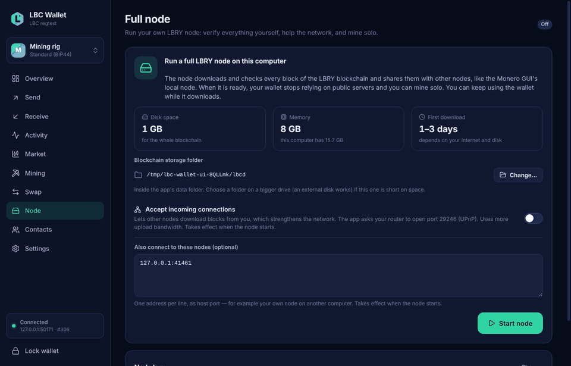

**Start it:**

1. Click **Node** in the menu.
2. **Choose where to store the blockchain:** under *Blockchain storage folder*, click
   **Change…** and pick a folder on a drive with enough space. (You can keep the default if
   your main drive is big enough.)
3. *Accept incoming connections* (optional): lets other nodes download from you, which helps the
   network. Leave it off if you are on a limited or mobile data plan.
4. Click **Start node**. The progress bar shows how much of the blockchain has been downloaded
   and checked, the number of **peers** (other nodes you are connected to) and the time left.
5. When it reaches **100 %**, the page says **"Your node is ready"** and the wallet
   automatically reads the blockchain from your own node.

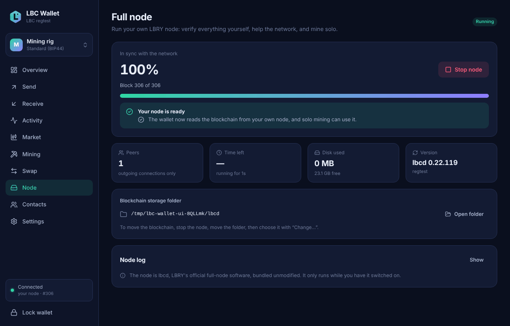

**Good to know:**

* The node runs while LBC Wallet is open. If you close the app, it pauses and continues where
  it stopped next time. If it was running when you closed the app, it starts again automatically.
* **Stop node** stops it (and it won't start automatically anymore).
* To **move** the blockchain to another disk: stop the node, move the folder with your file
  manager, then choose the new location with **Change…**.
* The node can also connect to specific nodes you trust: open *Show advanced options* on the
  Node page and enter their addresses (`host:port`).
* Advanced: you can also connect the wallet to an lbcd node you run yourself elsewhere
  (**Settings → Network → My own node**).

### Which servers does the wallet use?

Without a node, the wallet connects to one of these public LBRY servers ("hubs"), on port 50001.
It starts at a random one, tests that it is on the real LBC chain and up to date, and moves on
by itself when one is down or behind:

| Server | Run by |
| --- | --- |
| `a-hub1.odysee.com`, `b-hub1.odysee.com`, `c-hub1.odysee.com`, `s-hub1.odysee.com` | Odysee |
| `hub.lbry.grin.io` | the community |
| `hub.lizard.technology` | the community |
| `s1.lbry.network` | the community |

In our check on 18 October 2026, the four Odysee servers and `hub.lbry.grin.io` were up to date,
`s1.lbry.network` was about 230 blocks behind (the wallet skips it while it is), and
`hub.lizard.technology` did not answer. The **LBRY Foundation** publishes the hub software (its
source code is on its site and on GitHub as LBRYFoundation/hub) but, as far as we could find, does
not run a public server of its own; if it starts one, add it in **Settings → Network → Add a
server** (host name and port 50001), and it will appear in a later version's default list.

* **Test** in **Settings → Network** shows each server's response time and block height.
* You can add servers you trust, or remove the defaults and use only yours.
* The Android app uses the same list and the same checks.
* For the most privacy, use your own node (desktop) or route the connections through Tor
  (**Settings → Network → SOCKS5 proxy**, desktop).

The built-in node finds other nodes through LBRY's DNS seeds, and falls back to well-known nodes
(for example LBRYPool's) when the seeds give it none.

---

## 16. Settings

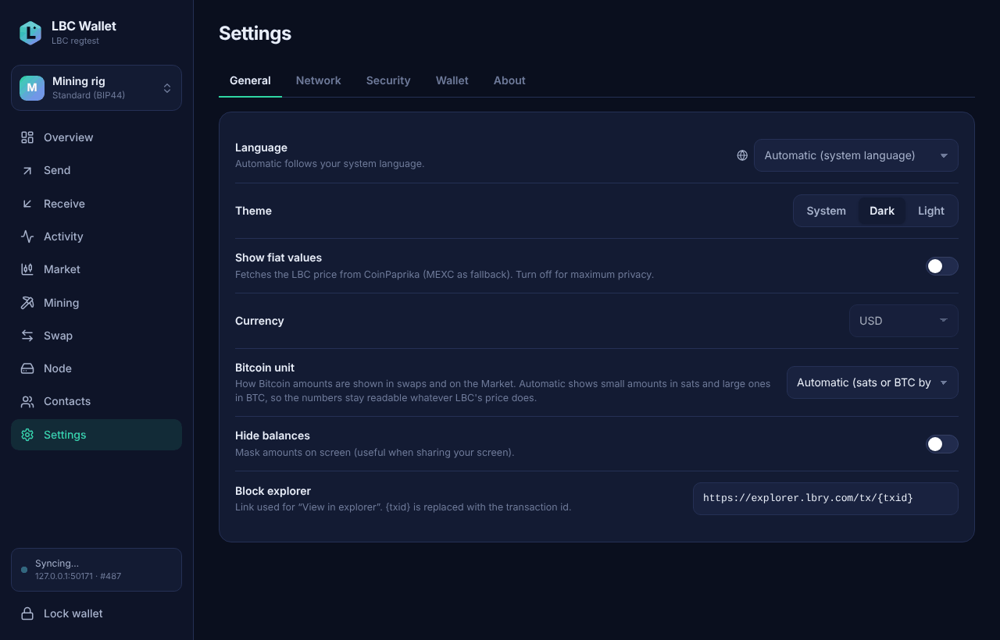

* **General:** language, theme (light/dark), fiat prices (USD, EUR…), **Bitcoin unit** (how
  Bitcoin amounts are shown in swaps and on the Market: *Automatic* uses sats for small amounts
  and BTC for large ones; or always BTC, always sats, or scientific notation like 2.05e-5 BTC),
  hide balances (useful when sharing your screen), block explorer link.
* **Network:** how the wallet reads the blockchain — **Public servers** (the default, fast and
  light), **Built-in node**, or **My own node**. You can add your own LBRY servers and route
  everything through **Tor** (SOCKS5 proxy) for more privacy. **Bitcoin explorer for swaps**
  lets you use your own Bitcoin server instead of blockstream.info (leave it empty if you don't
  know what that is). **Order board relays** lists the Nostr relays the Market uses (leave it
  empty for the default list).
* **Security:**
  * **Auto-lock** — the wallet locks itself after some minutes without use (15 by default) and
    when the computer sleeps. The inactivity lock waits while a swap is running.
  * **Ask for the password on every send** — strongly recommended (on by default).
  * **Change password**, **Show recovery phrase** (make sure nobody is watching!) and
    **Extended public key** (for watch-only wallets).
* **Wallet:** rename, default fee, **Rescan** (if a balance looks wrong), delete the wallet from
  this device.
* **About:** version, a **Not audited** reminder, the full disclaimer, links to the source code,
  updates and this manual.

---

## 17. Backups, new computers and new phones

**Your recovery phrase on paper is your backup.** With it you can always restore your wallet on
any device, even if your computer breaks or is stolen. Keep two copies in different safe places.

**Moving to a new computer or phone:** install LBC Wallet there, choose **Restore from a
recovery phrase** and type your words. Your money is on the blockchain, not in the device, so it
appears again.

**Where are my wallet files?** (encrypted with your password; you normally don't need them)

| System | Folder |
| --- | --- |
| Windows | `%APPDATA%\LBC Wallet` |
| Mac | `~/Library/Application Support/LBC Wallet` |
| Linux | `~/.config/LBC Wallet` |
| Android | inside the app (removed when the app is uninstalled) |

The exact folder is shown in **Settings → About → Data folder**.

---

## 18. Updating the app

When a new version is published, download it from the same
[Releases page](https://github.com/mnaghshvarian/lBC-wallet-with-mining-ability/releases/latest)
and install it over the old one, exactly like the first time. Your wallets and settings are kept.
**Settings → About → Check for updates** opens the page for you.

---

## 19. Problems and solutions

**"Disconnected" / "Connecting…" at the bottom left.** Check your internet connection. The
wallet tries several LBRY servers automatically. In **Settings → Network**, click **Test** next
to the servers to see which ones answer.

**My balance looks wrong.** Wait a minute for the wallet to sync. If it is still wrong:
**Settings → Wallet → Rescan**.

**I forgot my password.** Use **Restore from a recovery phrase** (on the unlock screen:
*"Forgot password? Restore from phrase"*) and choose a new password.

**I lost my recovery phrase but can still open the wallet.** Immediately go to
**Settings → Security → Show recovery phrase** and write it down.

**I lost both the phrase and the password.** Sadly, nobody can recover the wallet. This is how
non-custodial wallets work.

**Mining shows 0 H/s or an error.** Make sure a wallet is open. Check the **Log** box on the
Mining page for the reason (for example no internet, or the pool is down). Try again later or
choose another pool.

**"Paused (on battery)".** Plug in your laptop, or switch off *Pause on battery*.

**Mining on the phone says "Paused".** The message under the hashrate says why. Plug in the
charger, let the phone cool down, switch off battery saver, or keep LBC Wallet on the screen.

**A swap says "Waiting for the refund".** The other person didn't continue in time. Keep LBC
Wallet open with that wallet unlocked: your coins come back by themselves after the time shown.
Before you lock any coins, you can still **Cancel swap**.

**The node finds no peers.** Finding the first peers can take a few minutes; if none answer, the
app asks the node to try a list of known LBRY nodes. If it still shows 0 peers after 10 minutes,
check that your firewall allows LBC Wallet to connect to the internet (the node uses port 9246).
On restrictive networks (some offices, some countries) the LBRY network may be blocked: try Tor
(**Settings → Network**), or ask the LBRY community for the address of a node and enter it on the
Node page under *Show advanced options*.

**The node says there is not enough disk space.** Choose a folder on a bigger drive with
**Change…** on the Node page.

**Windows/Mac says the app is from an unknown developer.** See the steps in
[section 4](#4-install-on-windows) and [section 5](#5-install-on-a-mac).

**Something else?** Report it (you need a free GitHub account) at
<https://github.com/mnaghshvarian/lBC-wallet-with-mining-ability/issues>. Describe what you did
and what happened. **Never include your recovery phrase, password or private keys.**

---

## 20. Check that your download is genuine (optional)

Every release lists a **SHA-256 fingerprint** for each file (in the files called
`SHA256SUMS-…txt` on the Releases page). If the fingerprint of your download matches, the file
is exactly the official one.

* **Windows** (PowerShell): `Get-FileHash $HOME\Downloads\LBC-Wallet-Setup-x64.exe`
* **Mac** (Terminal): `shasum -a 256 ~/Downloads/LBC-Wallet-mac-arm64.dmg`
* **Linux**: `sha256sum ~/Downloads/lbc-wallet_amd64.deb`

Compare the long code it prints with the one in the `SHA256SUMS` file.

Everything is built automatically by GitHub from the public source code, so anyone can check
how the files were made.

---

## 21. Buy, sell or swap LBC

There are three ways:

* **On an exchange** such as MEXC: an exchange holds your coins while you trade.
* **On the Market** in LBC Wallet: other LBC Wallet users post offers to buy or sell LBC for
  Bitcoin, and a taken offer settles as an atomic swap; nobody holds your coins. See
  [section 22](#22-trade-on-the-market).
* **With a swap code**, with someone you already know: the **Swap** page, below.

### On an exchange

Today LBC trades on very few markets. In October 2026 the only market that price trackers such
as [CoinPaprika](https://coinpaprika.com/coin/lbc-lbry-credits/) still follow is **LBC/USDT on
MEXC**, with only a few hundred US dollars of trading per day. That means:

* **The price can jump** with a single large order, and selling a large amount may move it a lot.
* **An exchange holds your coins** while they are there (it is *custodial*). It can freeze
  withdrawals, ask for identity documents, delist LBC or close. Move your LBC back to your own
  wallet when you're done, and never leave more there than you can afford to lose.
* **Check the exchange's own page** for the LBC network, its deposit address and any deposit
  tag, and send a small amount first.
* Exchanges are not available everywhere. Follow the law of your country.

LBC Wallet is not connected to any exchange, and this is not a recommendation to buy or sell.

### Swap LBC and Bitcoin with another person

The **Swap** page trades LBC for Bitcoin (or Bitcoin for LBC) directly with someone you know,
for example from the LBRY community chat. **No exchange and no middleman** is involved. It uses
an *atomic swap*: each of you locks your coins in a contract on its own blockchain, and the
contracts are linked so that **either both of you get paid, or both of you get your coins back**.
Nobody can take your coins without giving you theirs.

**What you need:** LBC Wallet for the LBC side, any Bitcoin wallet to pay Bitcoin from (if you
give Bitcoin), and a Bitcoin address of yours to receive Bitcoin or a refund. The smallest swap is
**20,000 sats of Bitcoin** (0.0002 BTC, about 16 US dollars in October 2026). Below that, Bitcoin
fees would eat too much. The largest is **0.05 BTC**, while swaps are new.

**How it goes:**

1. Agree on the amounts with the other person, for example in a chat.
2. One of you clicks **Swap → Start a swap**, chooses what they give, enters the amounts and
   their Bitcoin address, and clicks **Create the invite**. They send the **invite code** to the
   other person. The code holds only public information.

   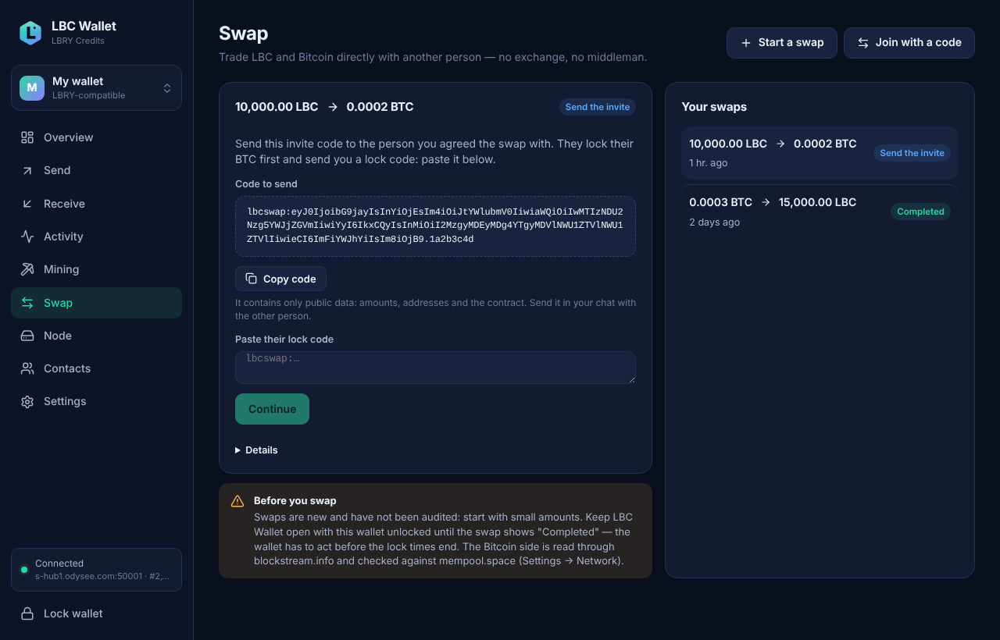

3. The other person clicks **Join with a code** and pastes it. **The person who joins locks
   first.** If they give Bitcoin, the wallet shows a Bitcoin address and the exact amount: pay
   it from any Bitcoin wallet in a single payment. If they give LBC, the wallet locks it after
   they enter their password. Then the wallet shows a **lock code** to send back.

   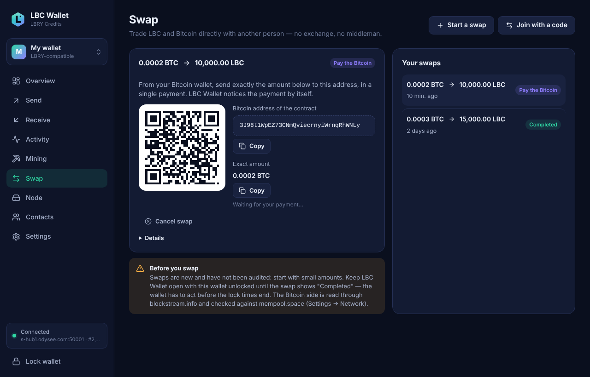

4. The person who started pastes that lock code. The wallet waits until the other coins are
   safely confirmed (2 Bitcoin blocks, about 20 minutes; or 12 LBC blocks, about 30 minutes) and
   checks them. Then it is their turn to lock: LBC with their password, or Bitcoin by paying the
   address and amount the wallet shows. The wallet then shows their own lock code to send back.

   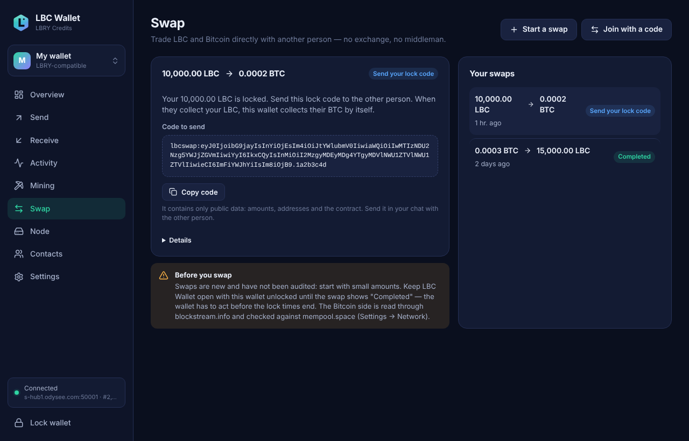

5. The person who joined pastes it. From here **the two wallets finish the swap by
   themselves**: each collects the other's coins. Both show **Completed**.

*(Pictures with sample amounts.)*

> [!IMPORTANT]
> * **Keep LBC Wallet open, with that wallet unlocked, until the swap shows "Completed".** The
>   wallet has to act before the lock times end. If the swap stops halfway, your coins come
>   back by themselves after the lock time (24 hours for the person who started, 48 hours for
>   the person who joined), but only while the app is open.
> * **Finish the swap on the same device.** Its keys are kept in that wallet on that device, not
>   in your recovery phrase. Don't uninstall the app or delete the wallet while a swap runs.
> * **Pay exactly the amount shown, in one payment,** and only to the address shown in your own
>   LBC Wallet, never to an address someone sends you in a chat.
> * Swaps are new and **not audited**. Start with the smallest amount.
> * **Pay into a contract once.** If the app says your Bitcoin payment was too small, do not send
>   a second payment to the same address: the app refunds only the first one. Wait for the refund
>   and start a new swap.
> * The inactivity auto-lock waits while a swap runs, so the wallet can collect or refund by
>   itself. Locking the wallet yourself, closing the app, sleep and the screen lock still stop it.
> * With public hubs, the wallet asks a **second hub** to confirm the other side's LBC payment
>   before it acts on it. If the hubs disagree, the swap shows a problem and nothing of yours
>   moves: switch hubs or use your own node (*Settings → Network*).
> * The wallet reads the Bitcoin blockchain through blockstream.info and double-checks
>   everything with mempool.space, so those two services see the contract addresses (not your
>   wallet). You can use your own Bitcoin server instead (**Settings → Network**).

**Why only Bitcoin?** An atomic swap needs both blockchains to support the same kind of locked
contract. Bitcoin, Litecoin and Dogecoin do. Litecoin or Dogecoin may come later, once there is
a reliable public server to read their blockchains. **USDT, Ethereum and Solana** would need a
contract written for those networks. **Monero** works very differently and needs much more
complex cryptography. Those may come later; until then there is no safe way to swap them
without a middleman. How to pay with them anyway, in two steps:
[section 23](#23-paying-with-usdt-monero-or-other-coins). See also the
[roadmap](../ROADMAP.md).

---

## 22. Trade on the Market

The **Market** page is an **order board**: other LBC Wallet users post offers to sell LBC for
Bitcoin or to buy LBC with Bitcoin, at their own prices, and you can take any of them — or post
your own. It works like the order book of an exchange, but **there is no exchange**: nobody holds
your coins, there is no account and no fee. When an offer is taken, the two wallets set up an
**atomic swap** between themselves (the same contracts as the **Swap** page, see
[section 21](#21-buy-sell-or-swap-lbc)), passing the codes along by themselves. Either both of you
get paid, or both of you get your coins back.

Offers and the messages between the two wallets travel through **Nostr relays**: public servers,
run by volunteers and companies, that pass short messages along. The messages are encrypted;
each offer and each trade uses a new key, so trades are not linked to your wallet or to each
other. LBC Wallet uses five free relays by default and you can change them in
**Settings → Network → Order board relays**.

### The first time

Click **Market** (on a phone: **More → Market**). The page first shows its own warning. Read it,
tick both boxes and click **I understand — open the board**.

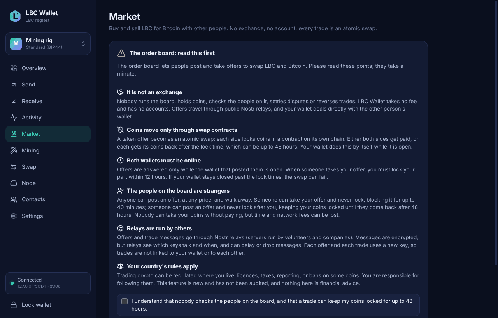

### Reading the board

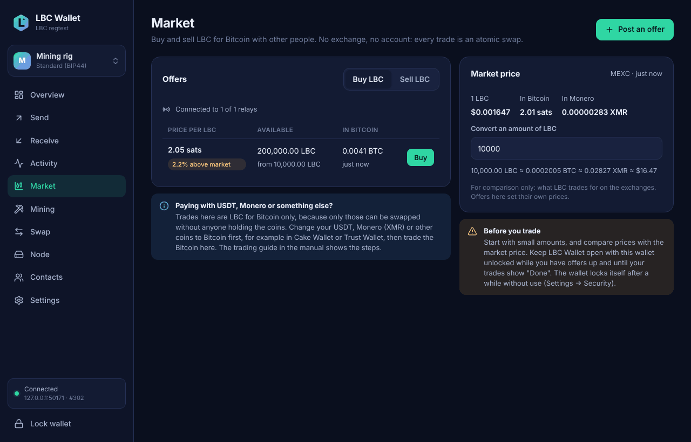

* **Buy LBC** lists the people *selling* LBC; **Sell LBC** lists the people *buying* it. The best
  price is at the top.
* **Price per LBC** is in **sats** (1 sat = 0.00000001 BTC). Next to it you see how far the price
  is **above or below the market price**.
* **Available** is how much LBC the offer still has, and **from …** the smallest part you can take.
* **In Bitcoin** is what the whole available amount costs. Small Bitcoin amounts are shown in
  **sats** and large ones in BTC, so the numbers stay readable whatever LBC's price does. Prefer
  one fixed unit — always BTC, always sats, or scientific notation such as 2.05e-5 BTC — under
  **Settings → General → Bitcoin unit**.
* **Market price** (right) shows what LBC trades for on the exchanges — the LBC/USDT market on
  MEXC (or CoinPaprika's average when MEXC cannot be reached) — in US dollars, sats and Monero, and
  converts any amount for you. It is only for comparison: offers set their own prices.

On a phone, open **More → Market**. Each offer is a block, with its **Buy** or **Sell** button on
the right:

| More → Market | The board on a phone |
| --- | --- |
| 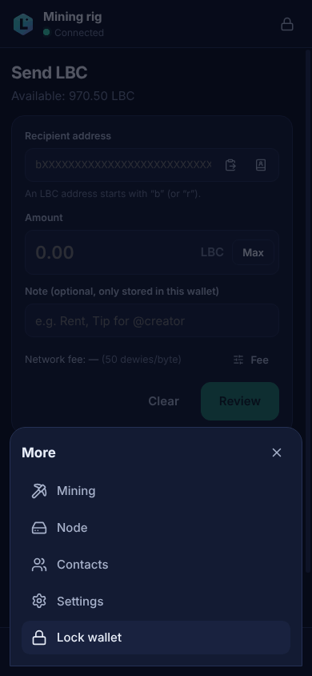 | 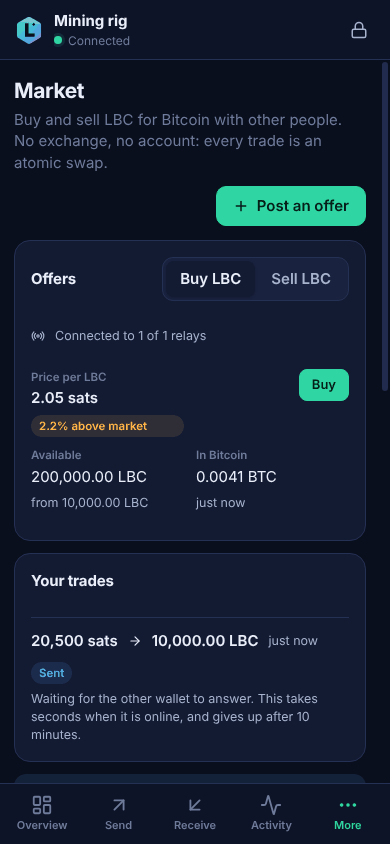 |

### Buy LBC (take a sell offer)

1. On **Buy LBC**, click **Buy** next to an offer.
2. Type how much LBC you want (between the offer's smallest part and what is available) and
   **your Bitcoin address for a refund** (any Bitcoin address of yours, for example from Trust
   Wallet or Cake Wallet). The window shows exactly what you give and get.

   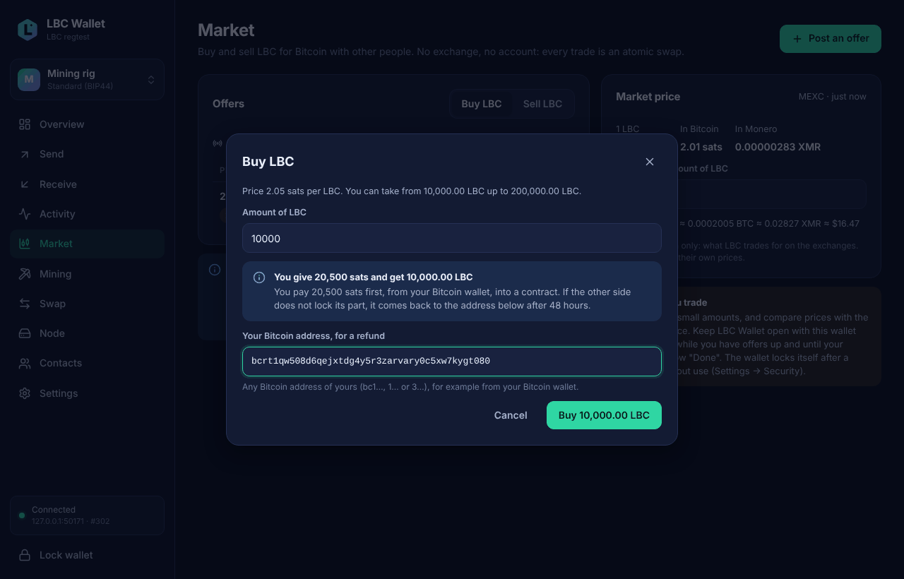

3. Click **Buy …**. The other wallet answers within seconds when it is online (it gives up after
   10 minutes if not; then nothing happened and you can try another offer).
4. When it accepts, **you lock first**: the window shows a Bitcoin **contract address** and the
   **exact amount**. Pay it **in one payment, from your Bitcoin wallet, within 20 minutes**.
5. Wait. After 2 Bitcoin confirmations (about 20 minutes) the seller's wallet asks them to lock
   their LBC, then 12 LBC confirmations (about 30 minutes) follow, and your wallet **collects the
   LBC by itself**. The trade shows **Done**.

### Sell LBC (take a buy offer)

1. On **Sell LBC**, click **Sell** next to an offer, type the amount, and **your Bitcoin address
   to receive the Bitcoin**.
2. When the other wallet accepts, **you lock first**: click **Lock …** and enter your password.
   Your LBC goes into the contract.
3. After 12 LBC confirmations (about 30 minutes) the buyer pays their Bitcoin into their contract;
   after 2 Bitcoin confirmations your wallet **collects the Bitcoin** to your address by itself.

### Post your own offer

1. Click **Post an offer**.
2. Choose **Sell LBC (get Bitcoin)** or **Buy LBC (pay Bitcoin)**, the amount of LBC, and your
   price in sats per LBC (**Use the market price** fills in the exchange price).
3. **Smallest part someone can take:** leave it empty for the smallest swap that is worth its
   network fees at your price (20,000 sats of Bitcoin, at least 10 LBC).
4. Enter your Bitcoin address (to receive Bitcoin, or for a refund when you buy) and click
   **Post the offer**.

   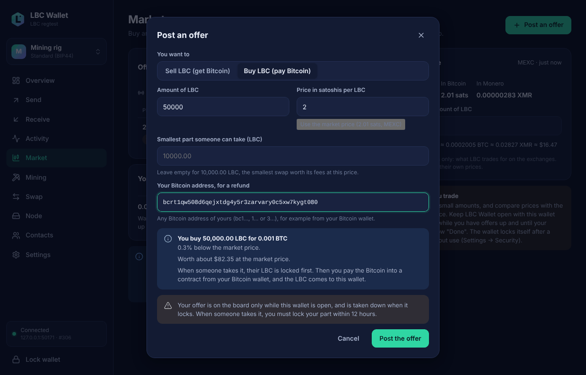

Your offer appears on the board and under **Your offers**, with how many relays carry it. It is
renewed every 20 minutes **while this wallet is open**, and taken down when the wallet locks or
when you click **Take down**.

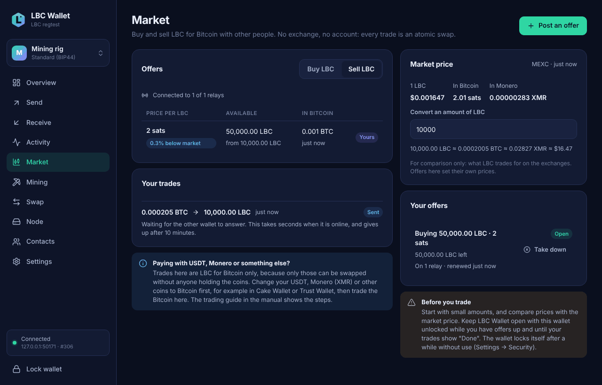

**When someone takes your offer**, LBC Wallet tells you ("Your offer was taken"). Their coins are
locked first. When they are confirmed, you get **"Swap: your turn"**: open **Market**, find the
trade under **Your trades**, and lock your part — LBC with your password, or Bitcoin by paying the
contract address and amount shown, from your Bitcoin wallet. **You have 12 hours to do this**;
after that the swap stops and their coins go back to them. Then both wallets collect by
themselves.

### Times to know

| What | How long |
| --- | --- |
| The other wallet answers a take | seconds; gives up after 10 minutes |
| The person who took an offer locks | within 20 minutes of the answer |
| The person who posted the offer waits for that lock | 40 minutes, then the offer is free again |
| Bitcoin is trusted after | 2 confirmations, about 20 minutes |
| LBC is trusted after | 12 confirmations, about 30 minutes |
| The person who posted locks | within 12 hours of being asked |
| Locked coins come back if the swap stops | after 48 hours (who took) or 24 hours (who posted) |

> [!IMPORTANT]
> * **Nobody checks the people on the board.** Anyone can post an offer at any price and walk
>   away. Someone can take your offer and never lock (your offer is blocked for up to 40
>   minutes), or post an offer and never lock after you (your coins stay locked until they come
>   back after 48 hours). Nobody can take your coins without paying, but you can lose time and
>   network fees.
> * **Keep LBC Wallet open, with that wallet unlocked,** while you have offers up and until your
>   trades show **Done**. Auto-lock (Settings → Security) takes your offers down.
> * **Compare the price** with the market price, and start with small amounts.
> * Pay Bitcoin **only to the contract address shown in your own LBC Wallet**, the exact amount,
>   in one payment.
> * The Market is new and **not audited**. Trading crypto may be regulated where you live
>   (licences, taxes, reporting): you are responsible for following those rules.

### Problems

* **"Connected to 0 of 5 relays"** — check your internet connection. Some networks block
  WebSocket connections; try another network, or other relays in **Settings → Network**.
* **Expired** ("No answer in time") — the wallet that posted the offer was not open. Nothing of
  yours was locked; try another offer.
* **Declined** — the offer was already taken, closed, or its price changed. Nothing was locked.
* **"Not on any relay yet"** under your offer — no relay could be reached; the wallet keeps
  trying.
* **The market price is not shown** — the price services could not be reached. Check the price
  on an exchange site before you trade.

---

## 23. Paying with USDT, Monero or other coins

The Market trades **LBC for Bitcoin only**, because only coins whose blockchains support the same
kind of locked contract can be swapped without anyone holding them. USDT is a token on other
networks (such as Tron or Ethereum) that would need a contract of its own; Monero has no such
contracts at all and needs very different cryptography (see [section 21](#21-buy-sell-or-swap-lbc)).

**Why doesn't LBC Wallet simply take deposits of USDT, Bitcoin or Monero and trade for you, like
an exchange?** Because whoever holds other people's coins becomes a custodian: in most countries
that needs a licence (money transmitter, virtual asset service provider, …), identity checks of
every user, audits and insurance, and it creates a single place that can be hacked, frozen or
run away with the money. That is exactly what LBC Wallet is built to avoid. Nobody — not the
developers, not a server — ever holds your coins.

So paying with another coin takes **two steps**: change it to Bitcoin first, then trade the
Bitcoin for LBC on the Market (or the other way round when you sell).

### Wallets you may already have

**Trust Wallet** and **Cake Wallet** do not hold LBC, but they hold Bitcoin, USDT and (Cake
Wallet) Monero, and both have a built-in exchange. Use them together with LBC Wallet:

* their **Bitcoin address** is "your Bitcoin address" on the Market (to receive Bitcoin, or for a
  refund);
* you **pay** the Bitcoin contract from them;
* their built-in exchange changes USDT or Monero to Bitcoin and back.

Their built-in exchanges use third-party services: those hold your coins for the few minutes of
the exchange, take a fee, and may ask for identity documents. Check the rate and start small.

### Buy LBC with USDT (example with Trust Wallet)

1. In Trust Wallet, **swap USDT for Bitcoin** (enough for the LBC plus about 5 % for fees).
2. In LBC Wallet, **Market → Buy LBC**, choose an offer, type the amount, and paste your **Trust
   Wallet Bitcoin address** as the refund address. Click **Buy …**.
3. When the other wallet accepts, LBC Wallet shows the contract address and exact amount. In
   Trust Wallet, **send** exactly that amount of Bitcoin to that address, in one payment.
4. Wait about an hour: the LBC arrives in LBC Wallet by itself.

### Buy LBC with Monero (example with Cake Wallet)

1. In Cake Wallet, use **Exchange** to change XMR to BTC, into Cake Wallet's own Bitcoin wallet.
   (Experienced users can also use a Monero–Bitcoin atomic-swap program such as UnstoppableSwap,
   which needs no third party.)
2. Continue as above, paying the contract from Cake Wallet's Bitcoin wallet.

### Sell LBC for USDT or Monero

1. In LBC Wallet, **Market → Sell LBC**, take an offer, and enter your **Trust Wallet or Cake
   Wallet Bitcoin address** to receive the Bitcoin. Lock your LBC.
2. When the trade shows **Done**, the Bitcoin is in that wallet: change it to USDT (Trust Wallet)
   or Monero (Cake Wallet) with its built-in exchange.

### Move ("withdraw") your coins

* **LBC** stays in LBC Wallet until you **Send** it, for example to another LBC wallet or to an
  exchange's LBC deposit address (check the exchange's page for its LBC network and send a small
  amount first).
* **Bitcoin** from a trade goes straight to the Bitcoin address you entered: it is already in
  your own wallet.

Without the Market, the only other option is an exchange that lists LBC (MEXC lists LBC/USDT),
where you deposit, trade and withdraw — with the exchange holding your coins meanwhile (see
[section 21](#21-buy-sell-or-swap-lbc)).

---

## Glossary

* **Address** — like an account number for receiving LBC. Real LBC addresses start with `b`.
* **Atomic swap** — a trade of two coins on two blockchains where either both payments happen
  or neither does. No middleman holds the coins.
* **Block** — a batch of transactions added to the blockchain about every 2.5 minutes.
* **Blockchain** — the public record of all LBC transactions, kept by thousands of computers.
* **Confirmation** — each new block after the one containing your payment. More confirmations
  mean more certainty.
* **Fee** — a tiny amount paid to miners to include your payment in a block.
* **Hashrate** — how fast your computer mines (hashes per second, H/s).
* **Hub / server** — a public LBRY server that helps light wallets read the blockchain. It never
  sees your keys.
* **Lock time** — in a swap, the time after which locked coins can go back to their owner.
* **Market / order board** — the page where LBC Wallet users post and take offers to swap LBC
  and Bitcoin, with no exchange in between.
* **Nostr relay** — a public server that passes short messages along; the Market uses relays for
  its offers and trade messages.
* **Offer** — an order on the board to sell or buy LBC at a price; you **take** someone's offer or
  **post** your own.
* **LBC / dewies** — LBRY Credits; 1 LBC = 100,000,000 dewies.
* **Mining** — using computing power to create new blocks; miners earn new LBC and fees.
* **Node (full node)** — a program that keeps and checks the whole blockchain.
* **Non-custodial** — you hold your own keys; no company can freeze or move your coins.
* **Pool** — a group of miners who share their rewards.
* **Recovery phrase (seed)** — the 12 or 24 words that can restore your wallet. Keep them secret.
* **sats** — the smallest unit of Bitcoin: 100,000,000 sats = 1 BTC.
* **Share** — a piece of mining work counted by the pool.
* **Solo mining** — mining alone; rare but full rewards.
* **Tips and supports** — LBC sent to creators on LBRY/Odysee, or put behind content to boost it.
* **Watch-only wallet** — a wallet that shows a balance but cannot send (no private keys).
* **xprv / xpub** — an extended private / public key: a technical form of a wallet's keys.

---

*LBC Wallet is open-source software under the MIT license, provided "as is", without warranty
of any kind. It is not affiliated with LBRY Inc., Odysee, the LBRY Foundation, or any exchange or
pool. See the [disclaimer](../../DISCLAIMER.md).*
